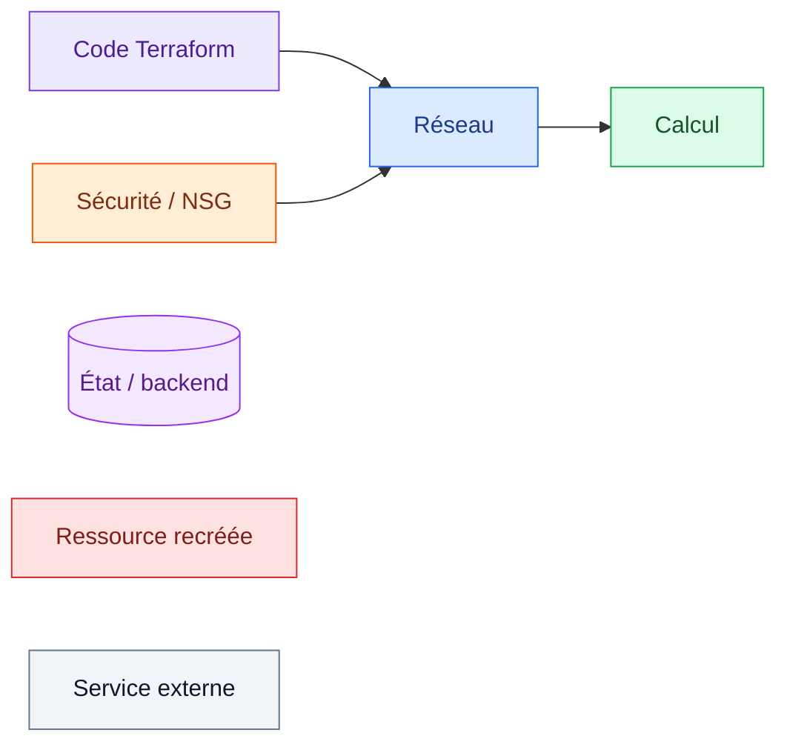

# 🟪 Formation Terraform sur Microsoft Azure — Labs à réaliser


Ce cahier adapte à Azure les 16 labs de la formation Terraform AWS. Les labs **02 à 09** font évoluer **un même projet fil rouge** (un serveur web Linux). Les labs suivants abordent l'état distant, HCP Terraform, les templates, le multi‑provider et un réseau complet.

---

## 🎨 Code couleur utilisé dans tous les labs

| Élément | Signification |
|---|---|
| 🔵 encadré **Note** | Information, rappel de cours |
| 🟢 encadré **Tip** | Bonne pratique, astuce |
| 🟣 encadré **Important** | Point clé à retenir |
| 🟠 encadré **Warning** | Piège fréquent, coût, comportement surprenant |
| 🔴 encadré **Caution** | Destruction, secret, action irréversible |
| Bloc `diff` | 🟩 lignes `+` à ajouter · 🟥 lignes `-` à retirer |
| ✏️ `TODO` | Trou à compléter par le stagiaire |
| 🔍 Observer | Lire le résultat **avant** d'agir |
| ✅ Vérification | Commande + résultat attendu |
| 🧯 Si vous voyez… | Erreur fréquente et sa solution |
| 🏆 Défi | Bonus pour les plus rapides |

Dans les schémas Mermaid :



---

## 🗓️ Planning des 2 jours

### Jour 1 — Les fondamentaux (8 h)

| Horaire | Séquence | Lab | Durée |
|---|---|---|---|
| 08:30 – 09:15 | 📘 Cours : IaC, Terraform, workflow, Azure Resource Manager | — | — |
| 09:15 – 09:45 | 🟦 Installation et authentification Azure | [Lab 01](lab01-installation.md) | 30 min |
| 09:45 – 10:45 | 🟩 Première infrastructure Azure | [Lab 02](lab02-premiere-infrastructure.md) | 60 min |
| 10:45 – 11:00 | ☕ *Pause* | | |
| 11:00 – 11:20 | 🟩 Les outputs | [Lab 03](lab03-outputs.md) | 20 min |
| 11:20 – 12:30 | 📘 Cours + lab : les variables | [Lab 04](lab04-variables.md) | 50 min |
| 13:30 – 14:30 | 📘 Cours + lab : les modules | [Lab 05](lab05-modules.md) | 60 min |
| 14:30 – 15:15 | 🟩 Provisioners et cloud-init | [Lab 06](lab06-provisioners.md) | 45 min |
| 15:15 – 15:30 | ☕ *Pause* | | |
| 15:30 – 16:30 | 🟪 Commandes, **dérive (drift)** et plan enregistré | [Lab 07](lab07-commandes.md) | 60 min |
| 16:30 – 17:30 | 🟧 Méta‑arguments `count` / `for_each` | [Lab 08](lab08-meta-arguments.md) | 60 min |

### Jour 2 — État, collaboration et réseau (8 h)

| Horaire | Séquence | Lab | Durée |
|---|---|---|---|
| 08:30 – 09:15 | 🟦 Sources de données et **`lifecycle`** | [Lab 09](lab09-data-sources.md) | 45 min |
| 09:15 – 09:35 | 🟪 Lire l'état d'un autre projet | [Lab 10](lab10-lecture-state.md) | 20 min |
| 09:35 – 10:20 | 🟪 État distant dans Azure Storage | [Lab 11](lab11-state-distant-azure.md) | 45 min |
| 10:20 – 10:35 | ☕ *Pause* | | |
| 10:35 – 11:50 | 🟪 HCP Terraform + GitHub | [Lab 12](lab12-hcp-terraform.md) | 75 min |
| 11:50 – 12:30 | 🟧 `templatefile` et RBAC | [Lab 13](lab13-templatefile.md) | 40 min |
| 13:30 – 14:15 | 🟧 Multi‑provider (Azure + GitHub) | [Lab 14](lab14-multi-provider.md) | 45 min |
| 14:15 – 15:05 | 🟦 Réseau virtuel complet (VNet) | [Lab 15](lab15-vnet.md) | 50 min |
| 15:05 – 15:20 | ☕ *Pause* | | |
| 15:20 – 16:00 | 🟩 VM dans le VNet | [Lab 16](lab16-vm-dans-vnet.md) | 40 min |
| 16:00 – 17:00 | 🏁 Bilan, quiz, **nettoyage général** ([`scripts/nettoyage.sh`](scripts/nettoyage.sh)) | — | — |

### 🚀 Lab complémentaire — Terraform en CI/CD

| Séquence | Lab | Durée |
|---|---|---|
| 🟪 Terraform dans un pipeline DevOps (GitHub Actions) : PR → plan, merge → apply, approbation | [Lab 17](lab17-pipeline-cicd.md) · [solution](solutions/lab17-pipeline-cicd/) | 60 – 75 min |

---

## 🧭 Vue d'ensemble du parcours

```mermaid
flowchart LR
    subgraph J1["Jour 1 — Projet fil rouge"]
        L01["01 Installation"]:::net --> L02["02 1re infra"]:::compute --> L03["03 Outputs"]:::compute --> L04["04 Variables"]:::tf
        L04 --> L05["05 Modules"]:::tf --> L06["06 Provisioners"]:::compute --> L07["07 Commandes + drift"]:::state --> L08["08 count / for_each"]:::sec
    end
    subgraph J2["Jour 2 — Industrialisation"]
        L09["09 Data + lifecycle"]:::net --> L10["10 Lire un state"]:::state --> L11["11 State Azure"]:::state --> L12["12 HCP Terraform"]:::state
        L13["13 templatefile + RBAC"]:::sec --> L14["14 Multi-provider"]:::sec
        L15["15 VNet complet"]:::net --> L16["16 VM dans VNet"]:::compute
    end
    L08 --> L09
    L12 --> L13
    L14 --> L15
    classDef tf fill:#ede9fe,stroke:#7c3aed,color:#4c1d95
    classDef net fill:#dbeafe,stroke:#2563eb,color:#1e3a8a
    classDef compute fill:#dcfce7,stroke:#16a34a,color:#14532d
    classDef sec fill:#ffedd5,stroke:#ea580c,color:#7c2d12
    classDef state fill:#f3e8ff,stroke:#9333ea,color:#581c87
```



---

## 📂 Organisation du dépôt

```text
terraform_GK/
├── README.md                     ← vous êtes ici
├── lab01-installation.md … lab16-vm-dans-vnet.md   ← 📗 les 16 labs à réaliser
├── lab17-pipeline-cicd.md      ← 🚀 lab complémentaire : Terraform dans un pipeline CI/CD
├── solutions/lab17-pipeline-cicd/   ← ✅ solution du lab 17 (dépôt GitHub type)
└── scripts/nettoyage.sh          ← 🧹 nettoyage de vos ressources Azure en fin de journée
```

---

## 🔁 Correspondance AWS → Azure

| Lab d'origine (AWS) | Concept AWS | Équivalent Azure utilisé |
|---|---|---|
| Lab 1 | Utilisateur IAM + clés d'accès | `az login` + Service Principal (`ARM_CLIENT_ID`…) |
| Lab 2 | `aws_instance` (EC2) | `azurerm_linux_virtual_machine` + NIC + IP publique |
| Lab 2 | VPC / subnet / security group | `azurerm_virtual_network` / `azurerm_subnet` / `azurerm_network_security_group` |
| Lab 3 | `public_ip`, `public_dns` | `azurerm_public_ip.ip_address`, `.fqdn` |
| Lab 4 | Map `AMIS` par région | Map de tailles de VM par environnement + map d'images |
| Lab 5 | Module `dynamic-keys` | Module registre `Azure/naming/azurerm` + `tls_private_key` |
| Lab 6 | Utilisateur `ubuntu` | Utilisateur `azureuser` |
| Lab 9 | `data "aws_ami"` | `data "azurerm_platform_image"` |
| Lab 11 | State sur Terraform Cloud | Backend `azurerm` (Storage Account + verrou par bail de blob) |
| Lab 12 | Terraform Cloud + creds AWS | HCP Terraform + variables `ARM_*` |
| Lab 13 | Bucket S3 + politique IAM | Storage Account + rôle personnalisé Azure RBAC |
| Lab 14 | Security group egress | Règles NSG sortantes |
| Lab 15 | Internet Gateway, route table, AZ | Routes système, route table, NAT Gateway, zones sur les ressources |
| Lab 16 | EC2 + key pair dans le VPC | VM Linux + clé SSH dans le VNet |

---

## ✅ Prérequis participants

- Un fichier **`~/.azure-tf.env`** fourni par le formateur (Service Principal personnel, voir lab 01).
- Un poste Linux, macOS ou Windows avec WSL2 (ou la VM Vagrant de la formation), **VS Code** + extension **HashiCorp Terraform** + **Remote - SSH**.
- Un compte GitHub (labs 12 et 14) et un compte HCP Terraform gratuit (lab 12).
- Une paire de clés SSH : `ssh-keygen -t rsa -b 4096`.

## 📏 Conventions

- Chaque participant reçoit un **identifiant unique** noté `<identity>` : **3 à 12 caractères, minuscules et chiffres uniquement** (ex. `student01`). Il entre dans des noms de comptes de stockage, qui refusent tirets et majuscules.
- Région par défaut : `francecentral`. Taille par défaut : `Standard_B1s` (alternative : `Standard_B2ats_v2`).
- Toutes vos ressources vivent dans des groupes de ressources `rg-<identity>-…`.
- **Variables Terraform en `snake_case` minuscule.** Les noms en MAJUSCULES sont réservés aux variables d'environnement (`ARM_*`, `TF_VAR_*`, `GITHUB_TOKEN`).

```text
~/terraform-azure/
├── lab01/
├── terraform/          # projet fil rouge (labs 02 → 09, puis 12)
├── lab04-exercice/     # exercice du lab 04, réutilisé au lab 06
├── lab10/  lab11/  lab13/  lab14/
└── lab15-16/           # réseau complet + VM
```

## 💶 Coûts et nettoyage

> [!WARNING]
> Les ressources sont petites (VM B1s, IP Standard, Storage LRS) mais **facturées à l'heure**. Le **NAT Gateway** du lab 15 est facturé même sans trafic.

À la fin de **chaque journée** :

```bash
terraform destroy                 # dans chaque répertoire de lab encore déployé
bash scripts/nettoyage.sh <identity>   # filet de sécurité : supprime tous vos rg-<identity>-*
```
