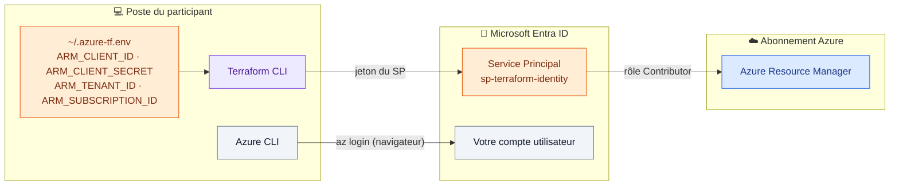

# 🟦 Lab 01 — Installation de Terraform et connexion à Azure

  

## 🎯 Objectifs

À la fin de ce lab, vous serez capable de :

- ✅ **installer** Terraform et l'Azure CLI, puis **vérifier** leurs versions ;
- ✅ **vous authentifier** sur Azure de deux façons : `az login` (utilisateur) et Service Principal (variables `ARM_*`) ;
- ✅ **expliquer** la différence entre ces deux méthodes ;
- ✅ **prouver** que Terraform parle à Azure Resource Manager sans créer de ressource.

## 📋 Prérequis

- Le fichier `<identity>.azure-tf.env` **remis par le formateur** (votre Service Principal personnel).
- Un terminal Linux, macOS ou WSL2 (ou la VM Vagrant de la formation).

## 🗺️ Architecture



---

## Étape 1 — Installer Terraform

### Ubuntu / Debian

```bash
# Clé GPG HashiCorp (la méthode apt-key est dépréciée)
wget -O- https://apt.releases.hashicorp.com/gpg | \
  sudo gpg --dearmor -o /usr/share/keyrings/hashicorp-archive-keyring.gpg

# Dépôt officiel HashiCorp
echo "deb [signed-by=/usr/share/keyrings/hashicorp-archive-keyring.gpg] \
https://apt.releases.hashicorp.com $(lsb_release -cs) main" | \
  sudo tee /etc/apt/sources.list.d/hashicorp.list

sudo apt-get update && sudo apt-get install -y terraform
```

<details>
<summary>🪟 Windows · 🎩 RHEL / Rocky</summary>

```powershell
winget install HashiCorp.Terraform
```

```bash
sudo yum install -y yum-utils
sudo yum-config-manager --add-repo https://rpm.releases.hashicorp.com/RHEL/hashicorp.repo
sudo yum -y install terraform
```

</details>

### ✅ Vérification

```bash
terraform version
terraform -install-autocomplete   # optionnel, puis rouvrir le terminal
```

```text
Terraform v1.9.x      ← (ou plus récent)
on linux_amd64
```

---

## Étape 2 — Installer l'Azure CLI

```bash
curl -sL https://aka.ms/InstallAzureCLIDeb | sudo bash   # Ubuntu / Debian
az version
```

---

## Étape 3 — Méthode 1 : `az login` (utilisateur)

```bash
az login
az account list --output table
az account set --subscription "<SUBSCRIPTION_ID>"   # si vous avez plusieurs abonnements
az account show --query "{abonnement:name, id:id, tenant:tenantId}" -o table
```

> [!NOTE]
> Avec `az login`, Terraform réutilise **votre** session Azure CLI : il a **tous vos droits** et utilise l'abonnement **actif** de la CLI. Pratique sur un poste de développement, impossible en CI/CD (il faut un navigateur).

---

## Étape 4 — Méthode 2 : le Service Principal (variables `ARM_*`)

Le formateur a créé pour vous une **identité applicative** `sp-terraform-<identity>` avec la commande :

```bash
# ⚠️ Commande formateur : elle exige le rôle Owner (elle crée une attribution de rôle)
az ad sp create-for-rbac --name "sp-terraform-<identity>" --role Contributor \
  --scopes "/subscriptions/<SUBSCRIPTION_ID>"
```

Installez le fichier qu'il vous a remis :

```bash
cp <identity>.azure-tf.env ~/.azure-tf.env
chmod 600 ~/.azure-tf.env          # lisible par vous seul
source ~/.azure-tf.env
env | grep ^ARM_ | sed 's/SECRET=.*/SECRET=***masqué***/'
```

> [!CAUTION]
> `ARM_CLIENT_SECRET` est un **mot de passe**. Ne le collez jamais dans un fichier `.tf`, un `terraform.tfvars`, un ticket ou un dépôt Git.

> [!TIP]
> Les variables n'existent que dans le terminal courant. Ajoutez `source ~/.azure-tf.env` à la fin de votre `~/.bashrc` pour ne pas l'oublier.

### 🔍 Observer : quelle identité utilise Terraform ?

| Ordre | Le provider `azurerm` essaie… | Quand ? |
|---|---|---|
| 1️⃣ | Client secret / certificat / OIDC | si `ARM_CLIENT_ID` + `ARM_CLIENT_SECRET` (ou équivalent) sont définis |
| 2️⃣ | Managed Identity | si `ARM_USE_MSI=true` |
| 3️⃣ | Azure CLI | sinon : votre session `az login` |

✏️ **TODO 1** — Complétez le tableau comparatif (réponse dans le corrigé) :

| Critère | `az login` | Service Principal |
|---|---|---|
| Identité utilisée | ____ | ____ |
| Interaction humaine nécessaire | ____ | ____ |
| Utilisable en CI/CD | ____ | ____ |
| Droits | ____ | ____ |

---

## Étape 5 — Test de connexion avec Terraform

```bash
mkdir -p ~/terraform-azure/lab01 && cd ~/terraform-azure/lab01
```

Créez `main.tf` :

```hcl
terraform {
  required_version = ">= 1.9"

  required_providers {
    azurerm = {
      source  = "hashicorp/azurerm"
      version = "~> 4.0"
    }
  }
}

provider "azurerm" {
  features {}
  # ✏️ TODO 2 : pourquoi n'écrit-on PAS subscription_id ici ?
}

data "azurerm_client_config" "current" {}

output "connexion" {
  value = {
    tenant_id       = data.azurerm_client_config.current.tenant_id
    subscription_id = data.azurerm_client_config.current.subscription_id
    client_id       = data.azurerm_client_config.current.client_id
  }
}
```

```bash
terraform init
terraform apply
```

### ✅ Vérification

```text
Changes to Outputs:
  + connexion = {
      + client_id       = "<appId de votre SP>"   ← doit correspondre à ARM_CLIENT_ID
      + subscription_id = "…"
      + tenant_id       = "…"
    }
```

Comparez : `echo $ARM_CLIENT_ID`. **Aucune ressource n'a été créée.**

### 🔍 Observer : basculer d'une méthode à l'autre

```bash
unset ARM_CLIENT_ID ARM_CLIENT_SECRET   # Terraform repasse sur az login
terraform apply                         # client_id change : c'est votre utilisateur
source ~/.azure-tf.env                  # retour au SP pour la suite de la formation
```

---

## 🧯 Si vous voyez…

| Message | Cause | Solution |
|---|---|---|
| `subscription ID could not be determined and was not specified` | `ARM_SUBSCRIPTION_ID` absent (obligatoire depuis azurerm 4) | `source ~/.azure-tf.env` |
| `AADSTS7000215: Invalid client secret provided` | secret mal copié ou expiré | redemandez le fichier au formateur |
| `AADSTS700016: Application … not found` | mauvais `ARM_CLIENT_ID` ou mauvais tenant | vérifiez `ARM_TENANT_ID` |
| `Error: Failed to query available provider packages` | pas d'accès à registry.terraform.io (proxy) | configurez `HTTPS_PROXY` |

## 🏆 Défi

Affichez uniquement le `client_id` en une ligne de shell, sans guillemets : `terraform output -json connexion | jq -r .client_id`.

## ❓ Questions de compréhension

1. Pourquoi un pipeline CI/CD ne peut-il pas utiliser `az login` ?
2. Que se passe-t-il si `ARM_CLIENT_ID` est défini mais pas `ARM_CLIENT_SECRET` ?
3. Pourquoi le stagiaire ne peut-il pas créer lui-même son Service Principal avec le rôle Contributor ?

## 🚀 Pour aller plus loin

- **Managed Identity** : Terraform exécuté depuis une VM Azure, sans aucun secret.
- **OIDC / Workload Identity Federation** : GitHub Actions ou HCP Terraform sans secret stocké (lab 12).
- `tenv` pour gérer plusieurs versions de Terraform sur un même poste.
