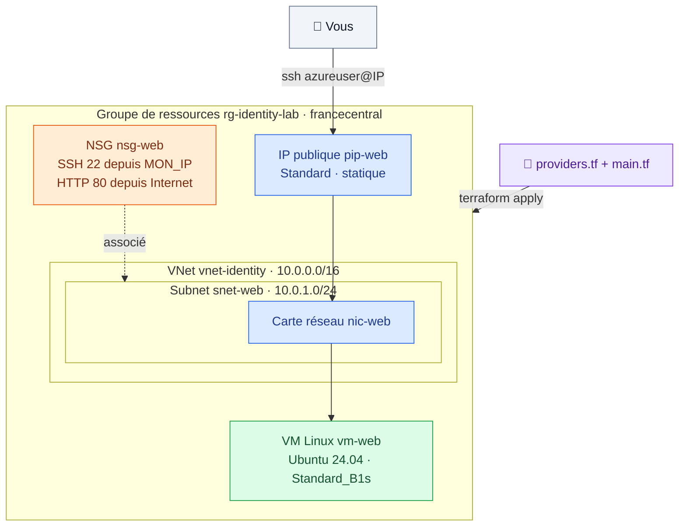

# 🟩 Lab 02 — Première infrastructure Azure

   

## 🎯 Objectifs

À la fin de ce lab, vous serez capable de :

- ✅ **écrire** une configuration HCL avec un provider et des ressources ;
- ✅ **exécuter** le cycle `init` → `plan` → `apply` et **lire** le résumé `add / change / destroy` ;
- ✅ **déployer** une VM Linux avec tout son réseau (VNet, subnet, NSG, IP publique, carte réseau) ;
- ✅ **distinguer** dans un plan une mise à jour sur place (`~`) d'une recréation (`-/+`) et **identifier** l'attribut responsable.

Ce projet est le **fil rouge** des labs 02 à 09.

## 📋 Prérequis

- Lab 01 terminé : `source ~/.azure-tf.env` fait dans ce terminal.
- Une clé SSH : `ls ~/.ssh/id_rsa.pub` (sinon `ssh-keygen -t rsa -b 4096`).
- Votre adresse IP publique : `curl -s ifconfig.me` → notée `<MON_IP>`.

## 🗺️ Architecture



---

## Étape 1 — Le projet et le provider

```bash
mkdir -p ~/terraform-azure/terraform && cd ~/terraform-azure/terraform
code .     # ou ouvrez le dossier dans VS Code (Remote-SSH)
```

Créez **dès maintenant** un `.gitignore` : le fichier d'état contiendra des informations sensibles.

```gitignore
.terraform/
*.tfstate
*.tfstate.*
*.tfvars
!*.tfvars.example
keys/
crash.log
```

Créez `providers.tf` :

```hcl
terraform {
  required_version = ">= 1.9"

  required_providers {
    azurerm = {
      source  = "hashicorp/azurerm"
      version = "~> 4.0"
    }
  }
}

provider "azurerm" {
  features {}
}
```

> [!IMPORTANT]
> Le bloc `features {}` est **obligatoire**, même vide. `subscription_id` est obligatoire depuis azurerm 4, mais **on ne l'écrit pas** : le provider le lit dans `ARM_SUBSCRIPTION_ID`.

> [!CAUTION]
> N'écrivez jamais `subscription_id = "ARM_SUBSCRIPTION_ID"` : entre guillemets, c'est une **chaîne littérale**. HCL ne lit pas les variables d'environnement.

---

## Étape 2 — La première ressource

Créez `main.tf` (remplacez `<identity>` par votre identifiant, ex. `student01`) :

```hcl
resource "azurerm_resource_group" "rg" {
  name     = "rg-<identity>-lab"
  location = "francecentral"
}
```

Anatomie d'une ressource :

```text
resource "azurerm_resource_group" "rg" {
          └─ PROVIDER_TYPE ─┘     └┬┘
                                  └── NOM LOCAL → référence : azurerm_resource_group.rg
```

```bash
terraform -help plan   # l'aide de chaque commande
terraform init         # télécharge le provider dans .terraform/ et crée .terraform.lock.hcl
terraform plan
```

### 🔍 Observer

```text
  # azurerm_resource_group.rg will be created
  + resource "azurerm_resource_group" "rg" {
      + id       = (known after apply)
      + location = "francecentral"
      + name     = "rg-student01-lab"
    }

Plan: 1 to add, 0 to change, 0 to destroy.
```

`(known after apply)` : la valeur n'existera qu'une fois la ressource créée par Azure.

```bash
terraform apply        # relisez le plan, puis répondez "yes"
az group show --name rg-<identity>-lab -o table
```

> [!TIP]
> `.terraform.lock.hcl` fige les versions exactes des providers : **il doit être versionné**.

---

## Étape 3 — Le réseau et la machine virtuelle

Sur AWS, une instance EC2 pouvait utiliser le VPC par défaut. Sur Azure, **il n'y a pas de réseau par défaut** : il faut le déclarer. Ajoutez à `main.tf` :

```hcl
resource "azurerm_virtual_network" "vnet" {
  name                = "vnet-<identity>"
  address_space       = ["10.0.0.0/16"]
  location            = azurerm_resource_group.rg.location
  resource_group_name = azurerm_resource_group.rg.name
}

resource "azurerm_subnet" "web" {
  name                 = "snet-web"
  resource_group_name  = azurerm_resource_group.rg.name
  virtual_network_name = azurerm_virtual_network.vnet.name
  address_prefixes     = ["10.0.1.0/24"]
}

resource "azurerm_network_security_group" "web" {
  name                = "nsg-web"
  location            = azurerm_resource_group.rg.location
  resource_group_name = azurerm_resource_group.rg.name

  security_rule {
    name                       = "Allow-SSH"
    priority                   = 100
    direction                  = "Inbound"
    access                     = "Allow"
    protocol                   = "Tcp"
    source_port_range          = "*"
    destination_port_range     = "22"
    source_address_prefix      = "____"   # ✏️ TODO 1 : votre IP au format CIDR
    destination_address_prefix = "*"
  }

  security_rule {
    name                       = "Allow-HTTP"
    priority                   = 110
    direction                  = "Inbound"
    access                     = "Allow"
    protocol                   = "Tcp"
    source_port_range          = "*"
    destination_port_range     = "80"
    source_address_prefix      = "*"
    destination_address_prefix = "*"
  }
}

resource "azurerm_subnet_network_security_group_association" "web" {
  subnet_id                 = azurerm_subnet.web.id
  network_security_group_id = azurerm_network_security_group.web.id
}

resource "azurerm_public_ip" "web" {
  name                = "pip-web"
  location            = azurerm_resource_group.rg.location
  resource_group_name = azurerm_resource_group.rg.name
  allocation_method   = "Static"
  sku                 = "Standard"
  domain_name_label   = "<identity>-web"   # unique dans la région
}

resource "azurerm_network_interface" "web" {
  name                = "nic-web"
  location            = azurerm_resource_group.rg.location
  resource_group_name = azurerm_resource_group.rg.name

  ip_configuration {
    name                          = "internal"
    subnet_id                     = ____   # ✏️ TODO 2 : référence au subnet
    private_ip_address_allocation = "Dynamic"
    public_ip_address_id          = ____   # ✏️ TODO 3 : référence à l'IP publique
  }
}

resource "azurerm_linux_virtual_machine" "web" {
  name                  = "vm-web"
  location              = azurerm_resource_group.rg.location
  resource_group_name   = azurerm_resource_group.rg.name
  size                  = "Standard_B1s"
  admin_username        = "azureuser"
  network_interface_ids = [azurerm_network_interface.web.id]

  admin_ssh_key {
    username   = "azureuser"
    public_key = file("~/.ssh/id_rsa.pub")
  }

  os_disk {
    caching              = "ReadWrite"
    storage_account_type = "Standard_LRS"
  }

  source_image_reference {
    publisher = "Canonical"
    offer     = "ubuntu-24_04-lts"
    sku       = "server"
    version   = "latest"
  }
}
```

<details>
<summary>💡 Indice pour les TODO 2 et 3</summary>

Une référence s'écrit `<TYPE>.<NOM_LOCAL>.<ATTRIBUT>`. L'identifiant Azure d'une ressource est son attribut `id`.

</details>

> [!NOTE]
> - Les références (`azurerm_resource_group.rg.name`) créent des **dépendances implicites** : Terraform construit un graphe et crée les ressources dans le bon ordre, en parallèle quand c'est possible.
> - `source_image_reference` joue le rôle de l'**AMI** AWS ; `Standard_B1s` (1 vCPU, 1 Go) celui du `t2.micro`.
> - Une IP publique **Standard** bloque tout le trafic entrant tant qu'un NSG ne l'autorise pas.

```bash
terraform fmt          # remet le code au format canonique
terraform validate     # vérifie syntaxe et références
terraform plan
```

### 🔍 Observer

✏️ **TODO 4** — Avant d'appliquer, notez la ligne de résumé du plan : `Plan: __ to add, __ to change, __ to destroy.` Pourquoi ce nombre et pas 8 ?

```bash
terraform apply
terraform show | grep -E '^\s+ip_address'
ssh azureuser@<IP_PUBLIQUE>      # puis : exit
```

---

## Étape 4 — Mettre à jour la configuration

Ajoutez les tags dans la ressource VM :

```diff
 resource "azurerm_linux_virtual_machine" "web" {
   # ... arguments existants inchangés ...
+
+  tags = {
+    Identity    = "<identity>"
+    Name        = "Web"
+    Environment = "Training"
+  }
 }
```

```bash
terraform apply
```

```text
  # azurerm_linux_virtual_machine.web will be updated in-place
  ~ resource "azurerm_linux_virtual_machine" "web" {
      ~ tags = {
          + "Environment" = "Training"
          + "Identity"    = "student01"
          + "Name"        = "Web"
        }
    }

Plan: 0 to add, 1 to change, 0 to destroy.
```

### 🔍 Observer : mise à jour ou recréation ?

Faites ces deux expériences avec `terraform plan` **uniquement** (n'appliquez pas) :

| Modification | Symbole attendu | Ligne à chercher |
|---|---|---|
| `size = "Standard_B1ms"` | 🟨 `~` update in-place | (redimensionnement avec redémarrage) |
| `admin_username = "admin2"` (et dans `admin_ssh_key`) | 🟥 `-/+` must be replaced | `# forces replacement` |

✏️ **TODO 5** — Notez l'attribut marqué `# forces replacement` dans la 2ᵉ expérience, puis **revenez aux valeurs initiales** : `terraform plan` doit afficher `No changes`.

| Symbole | Signification |
|---|---|
| 🟩 `+` | création |
| 🟨 `~` | modification sur place |
| 🟥 `-/+` | destruction puis recréation (`forces replacement`) |
| ⬛ `-` | destruction |

> [!WARNING]
> Changer `name`, `location` ou `resource_group_name` force **presque toujours** la recréation. Changer le `location` du groupe de ressources recrée **tout ce qu'il contient**.

---

## ✅ Vérification

- [ ] `terraform state list` affiche **8** ressources.
- [ ] `ssh azureuser@<IP>` fonctionne depuis votre poste.
- [ ] Les tags apparaissent sur la VM : `az vm show -g rg-<identity>-lab -n vm-web --query tags`.
- [ ] `terraform plan` affiche `No changes. Your infrastructure matches the configuration.`

## 🧯 Si vous voyez…

| Message | Cause | Solution |
|---|---|---|
| `SkuNotAvailable` | B1s indisponible dans la région | `size = "Standard_B2ats_v2"` |
| `DnsRecordInUse` / `DomainNameLabel … not available` | `domain_name_label` déjà pris | vérifiez votre `<identity>` |
| `Invalid function argument … no file exists at "~/.ssh/id_rsa.pub"` | pas de clé SSH | `ssh-keygen -t rsa -b 4096` |
| `ssh: connect to host … port 22: Connection timed out` | votre IP a changé ou le CIDR est faux | `curl -s ifconfig.me`, corrigez la règle, `apply` |
| `QuotaExceeded … cores` | quota vCPU de l'abonnement atteint | prévenez le formateur |

## 🏆 Défi

Ajoutez une règle NSG `Allow-HTTPS` (port 443, priorité 120). Quel symbole affiche le plan pour le NSG ?

## ❓ Questions de compréhension

1. Que contient le répertoire `.terraform/` ? Et `.terraform.lock.hcl` ? Lequel versionne-t-on ?
2. Pourquoi Terraform sait-il qu'il doit créer le VNet **avant** le subnet ?
3. Quelle est la différence entre `~` et `-/+` dans un plan ? Donnez un exemple de chaque.
4. Pourquoi n'écrit-on pas `subscription_id` dans `providers.tf` ?

> [!IMPORTANT]
> **Gardez cette infrastructure** : elle est réutilisée dans les labs suivants.
