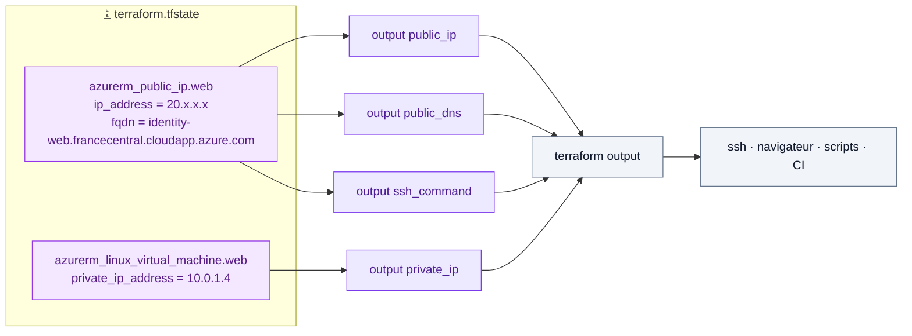

# 🟩 Lab 03 — Les outputs

   

## 🎯 Objectifs

À la fin de ce lab, vous serez capable de :

- ✅ **déclarer** des blocs `output` pour exposer l'IP publique, le DNS et l'IP privée ;
- ✅ **interroger** les outputs en texte, en brut (`-raw`) et en JSON (`-json`) ;
- ✅ **construire** une valeur par interpolation de chaîne `"${...}"` ;
- ✅ **masquer** une valeur avec `sensitive = true` et **expliquer** ce que cela protège (et ne protège pas).

## 📋 Prérequis

Lab 02 déployé dans `~/terraform-azure/terraform`.

## 🗺️ Architecture



---

## Étape 1 — Créer les outputs

Dans `~/terraform-azure/terraform`, créez `outputs.tf` :

```hcl
output "public_ip" {
  description = "Adresse IP publique du serveur web"
  value       = azurerm_public_ip.web.ip_address
}

output "public_dns" {
  description = "Nom DNS public du serveur web"
  value       = azurerm_public_ip.web.fqdn
}
```

> [!NOTE]
> Sur AWS, ces attributs étaient portés par l'instance (`aws_instance.web.public_ip`). Sur Azure, ils sont portés par la ressource **IP publique**. La VM expose aussi `public_ip_address` et `private_ip_address`.

```bash
terraform apply
```

### 🔍 Observer

```text
Changes to Outputs:
  + public_dns = "student01-web.francecentral.cloudapp.azure.com"
  + public_ip  = "20.x.x.x"

You can apply this plan to save these new output values to the Terraform state,
without changing any real infrastructure.
```

Ajouter un output **ne modifie aucune ressource** : seul l'état est mis à jour.

---

## Étape 2 — Interroger les outputs

```bash
terraform output                 # tous
terraform output public_dns      # un seul (avec guillemets)
terraform output -raw public_ip  # brut, idéal dans un script
terraform output -json           # pour jq ou la CI
ssh azureuser@$(terraform output -raw public_ip)
```

---

## Étape 3 — Exercices

✏️ **TODO 1** — Ajoutez un output `private_ip` :

```hcl
output "private_ip" {
  description = "Adresse IP privée de la VM"
  value       = ____   # attribut de la VM
}
```

✏️ **TODO 2** — Ajoutez un output `ssh_command` qui affiche la commande SSH complète par **interpolation** :

```hcl
output "ssh_command" {
  value = "ssh azureuser@____"   # insérez l'IP publique avec ${...}
}
```

✏️ **TODO 3** — Ajoutez `sensitive = true` à `ssh_command`, puis comparez :

```bash
terraform apply
terraform output                  # que voyez-vous ?
terraform output -raw ssh_command # et ici ?
grep -A3 '"ssh_command"' terraform.tfstate
```

> [!WARNING]
> `sensitive = true` masque la valeur **à l'écran** (plan, apply, `terraform output`). Elle reste **en clair dans le fichier d'état**. Protéger l'état est donc indispensable (lab 11).

Retirez `sensitive = true` avant de continuer.

---

## ✅ Vérification

- [ ] `terraform output` affiche `public_ip`, `public_dns`, `private_ip` et `ssh_command`.
- [ ] `$(terraform output -raw ssh_command)` vous connecte à la VM.
- [ ] `terraform plan` affiche `No changes`.

## 🧯 Si vous voyez…

| Message | Cause | Solution |
|---|---|---|
| `Warning: No outputs found` | outputs déclarés mais pas encore appliqués | `terraform apply` |
| `Reference to undeclared resource` | faute dans le nom local (`web`) | `terraform state list` pour retrouver l'adresse |
| `Output refers to sensitive values` | output dérivé d'une valeur sensible | ajoutez `sensitive = true` à l'output |

## 🏆 Défi

Créez un output `url` qui vaut `http://<fqdn>` et ouvrez-le avec `xdg-open $(terraform output -raw url)`. Le serveur web n'existe pas encore : quelle erreur obtenez-vous ? (Réponse au lab 06.)

## ❓ Questions de compréhension

1. Pourquoi l'ajout d'un output ne crée-t-il aucune ressource ?
2. Quelle option de `terraform output` utiliser dans un script shell ? Pourquoi ?
3. Une valeur marquée `sensitive` est-elle chiffrée dans l'état ?
