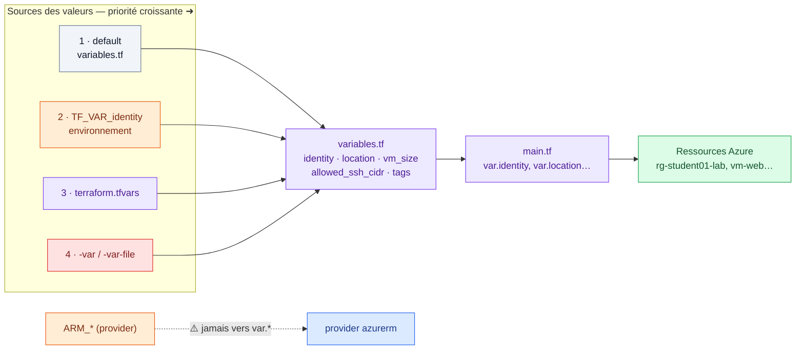

# 🟪 Lab 04 — Les variables

   

## 🎯 Objectifs

À la fin de ce lab, vous serez capable de :

- ✅ **déclarer** des variables typées avec description, valeur par défaut et **règle de validation** ;
- ✅ **remplacer** toutes les valeurs codées en dur du fil rouge par `var.<nom>` ;
- ✅ **fournir** une valeur de 4 façons (`default`, `terraform.tfvars`, `TF_VAR_*`, `-var`) et **prédire** laquelle l'emporte ;
- ✅ **distinguer** une variable d'environnement `ARM_*` (lue par le provider) d'une `TF_VAR_*` (lue par Terraform) ;
- ✅ **utiliser** les types `list`, `map`, `object` et la fonction `lookup`.

## 📋 Prérequis

Labs 02 et 03 déployés dans `~/terraform-azure/terraform`.

## 🗺️ Architecture



---

## Étape 1 — Déclarer les variables

Dans `~/terraform-azure/terraform`, créez `variables.tf` :

```hcl
variable "identity" {
  description = "Identifiant unique du participant (3 à 12 caractères, minuscules et chiffres)"
  type        = string

  validation {
    condition     = can(regex("____", var.identity))   # ✏️ TODO 1 : l'expression régulière
    error_message = "identity doit contenir 3 à 12 caractères, minuscules et chiffres uniquement (ex. student01)."
  }
}

variable "location" {
  description = "Région Azure"
  type        = string
  default     = "francecentral"
}

variable "vm_size" {
  description = "Taille de la machine virtuelle"
  type        = string
  default     = "Standard_B1s"
}

variable "admin_username" {
  description = "Utilisateur administrateur de la VM"
  type        = string
  default     = "azureuser"
}

variable "address_space" {
  description = "Plage d'adresses du VNet"
  type        = list(string)
  default     = ["10.0.0.0/16"]
}

variable "allowed_ssh_cidr" {
  description = "Adresse autorisée en SSH, au format CIDR (votre IP : curl -s ifconfig.me)"
  type        = string
}

variable "tags" {
  description = "Tags communs à toutes les ressources"
  type        = map(string)
  default = {
    Environment = "Training"
  }
}
```

> [!NOTE]
> Une variable **sans `default`** est **obligatoire** : Terraform la demande si aucune valeur n'est fournie. Une `validation` est évaluée **dès le plan**, avant tout appel à Azure.

> [!IMPORTANT]
> **Convention :** variables Terraform en `snake_case` minuscule. Les MAJUSCULES sont réservées aux variables d'environnement.

---

## Étape 2 — Utiliser les variables dans le code

Modifiez `main.tf` :

```diff
 resource "azurerm_resource_group" "rg" {
-  name     = "rg-<identity>-lab"
-  location = "francecentral"
+  name     = "rg-${var.identity}-lab"
+  location = var.location
+  tags     = var.tags
 }

 resource "azurerm_virtual_network" "vnet" {
-  name                = "vnet-<identity>"
-  address_space       = ["10.0.0.0/16"]
+  name                = "vnet-${var.identity}"
+  address_space       = var.address_space
```

```diff
     destination_port_range     = "22"
-    source_address_prefix      = "203.0.113.10/32"
+    source_address_prefix      = var.allowed_ssh_cidr
```

```diff
-  domain_name_label   = "<identity>-web"
+  domain_name_label   = "${var.identity}-web"
```

```diff
 resource "azurerm_linux_virtual_machine" "web" {
-  size                  = "Standard_B1s"
-  admin_username        = "azureuser"
+  size                  = var.vm_size
+  admin_username        = var.admin_username
   ...
   admin_ssh_key {
-    username   = "azureuser"
+    username   = var.admin_username
   ...
-  tags = {
-    Identity    = "<identity>"
-    Name        = "Web"
-    Environment = "Training"
-  }
+  tags = merge(var.tags, {
+    Identity = var.identity
+    Name     = "Web"
+  })
 }
```

✏️ **TODO 2** — Dans `outputs.tf`, remplacez `azureuser` par la variable dans `ssh_command`.

> [!TIP]
> `merge()` combine les tags communs et les tags propres à la ressource. Le résultat est **identique** aux tags du lab 02 : `Environment`, `Identity`, `Name`.

### 🔍 Observer : la saisie interactive

```bash
terraform plan
```

```text
var.allowed_ssh_cidr
  Adresse autorisée en SSH, au format CIDR (votre IP : curl -s ifconfig.me)

  Enter a value:
```

Quittez avec `Ctrl+C`.

---

## Étape 3 — Le fichier `terraform.tfvars`

Créez `terraform.tfvars` (**non versionné**, voir `.gitignore`) et sa copie modèle `terraform.tfvars.example` (**versionnée**) :

```hcl
identity         = "<identity>"
allowed_ssh_cidr = "<MON_IP>/32"
```

```bash
terraform plan
```

### 🔍 Observer

✏️ **TODO 3** — Le plan n'affiche **pas** `No changes`. Notez le résumé et la ressource concernée. Pourquoi ? Est-ce dangereux ?

<details>
<summary>💡 Indice</summary>

Comparez le bloc `azurerm_resource_group.rg` du lab 02 et celui d'aujourd'hui : une ligne a été **ajoutée**, pas seulement remplacée.

</details>

```bash
terraform apply
terraform plan     # cette fois : No changes.
```

---

## Étape 4 — Les autres façons de passer une valeur

```bash
terraform plan -var="vm_size=Standard_B1ms"       # ligne de commande (priorité maximale)
export TF_VAR_vm_size="Standard_B1ms"              # variable d'environnement
terraform plan -var-file="prod.tfvars"             # fichier dédié
unset TF_VAR_vm_size
```

✏️ **TODO 4** — Prédisez le résultat, puis vérifiez avec `terraform plan` :

```bash
export TF_VAR_vm_size="Standard_B1ms"
terraform plan -var="vm_size=Standard_B2s"   # quelle taille ? ____
unset TF_VAR_vm_size
```

| Priorité | Source |
|---|---|
| 🟥 4 (gagne) | `-var` et `-var-file`, dans l'ordre de la ligne de commande |
| 🟪 3 | `terraform.tfvars`, puis `*.auto.tfvars` (qui l'emporte) |
| 🟧 2 | `TF_VAR_<nom>` |
| ⬜ 1 | `default` |

> [!CAUTION]
> `terraform.tfvars` est souvent versionné par erreur. N'y mettez **jamais** de secret (client secret, mot de passe, token) : utilisez `TF_VAR_<nom>` ou les variables `ARM_*`.

---

## Étape 5 — Valider une variable

✏️ **TODO 5** — Ajoutez sur `location` une validation n'autorisant que `francecentral`, `westeurope` et `northeurope` (fonction `contains`). Testez :

```bash
terraform plan -var="location=eastus"
terraform plan -var="identity=Student-01"
```

---

## Exercice — Découper un projet, `lookup` et le piège `ARM_*`

```bash
mkdir -p ~/terraform-azure/lab04-exercice && cd $_
```

### 1. Quatre fichiers

| Fichier | Contenu |
|---|---|
| `provider.tf` | bloc `terraform` (avec `required_providers` épinglé `~> 4.0`) + provider |
| `variables.tf` | `identity`, `location` (défaut `francecentral`), `env` (défaut `dev`), `allowed_ssh_cidr` |
| `terraform.tfvars` | `identity`, `allowed_ssh_cidr` |
| `instance.tf` | groupe `rg-${var.identity}-exercice`, réseau `10.4.0.0/16` et VM, sur le modèle du lab 02 |

### 2. 🔍 Observer : le piège `ARM_*` ≠ `var.*`

Ajoutez temporairement dans `variables.tf` :

```hcl
variable "ARM_SUBSCRIPTION_ID" {}
```

```bash
echo $ARM_SUBSCRIPTION_ID     # la variable d'environnement existe…
terraform plan                # … et pourtant ?
```

✏️ **TODO 6** — Que demande Terraform ? Quelle variable d'environnement aurait rempli `var.ARM_SUBSCRIPTION_ID` ? Supprimez ensuite cette déclaration.

> [!IMPORTANT]
> - `ARM_*` → lues par le **provider** `azurerm`.
> - `TF_VAR_<nom>` → lues par **Terraform** pour remplir `variable "<nom>"`.
> - Une chaîne entre guillemets n'est **jamais** interprétée.

### 3. Taille de VM selon l'environnement

```hcl
variable "vm_sizes" {
  type = map(string)
  default = {
    dev  = "Standard_B1s"
    test = "Standard_B1ms"
    prod = "Standard_B2s"
  }
}
```

✏️ **TODO 7** — Dans la VM, choisissez la taille avec `lookup` (3ᵉ argument : valeur par défaut `Standard_B1s`), puis testez `terraform plan -var="env=prod"`.

### 4. 🏆 Défi : une map d'objets pour l'image

```hcl
variable "images" {
  type = map(object({
    publisher = string
    offer     = string
    sku       = string
  }))
  default = {
    ubuntu2404 = { publisher = "Canonical", offer = "ubuntu-24_04-lts", sku = "server" }
    ubuntu2204 = { publisher = "Canonical", offer = "0001-com-ubuntu-server-jammy", sku = "22_04-lts-gen2" }
    debian12   = { publisher = "Debian", offer = "debian-12", sku = "12-gen2" }
  }
}

variable "os" {
  type    = string
  default = "ubuntu2404"
}
```

Utilisez `var.images[var.os].publisher` (etc.) dans `source_image_reference`. Que donne `terraform plan -var="os=debian12"` sur une VM déjà déployée ?

> [!TIP]
> Conservez ce répertoire : il est réutilisé au lab 06. Pensez à `terraform destroy` en fin de journée.

---

## ✅ Vérification

- [ ] `grep -nE 'student|francecentral|203\.' main.tf` ne renvoie **rien** dans le fil rouge.
- [ ] `terraform plan` sur le fil rouge indique **No changes**.
- [ ] `terraform plan -var="identity=Student-01"` échoue sur la validation.
- [ ] `terraform plan -var="env=prod"` dans l'exercice propose `Standard_B2s`.

## 🧯 Si vous voyez…

| Message | Cause | Solution |
|---|---|---|
| `No value for required variable` | variable sans défaut, aucune valeur fournie | `terraform.tfvars` ou `TF_VAR_<nom>` |
| `Invalid value for variable … identity doit contenir…` | votre validation fonctionne 🎉 | corrigez la valeur |
| `Value for undeclared variable` | une clé du `.tfvars` n'est déclarée nulle part | faute de frappe ou bloc `variable` manquant |
| `Inconsistent dependency lock file` | provider ajouté sans `init` | `terraform init` |

## ❓ Questions de compréhension

1. Pourquoi `TF_VAR_identity` est-il pratique en CI/CD, et `terraform.tfvars` pratique en local ?
2. `export ARM_CLIENT_SECRET=…` remplit-il une `variable "client_secret"` ? Pourquoi ?
3. À quel moment une règle `validation` est-elle évaluée ?
4. Pourquoi changer `os` sur une VM existante provoque-t-il un `-/+` ?
