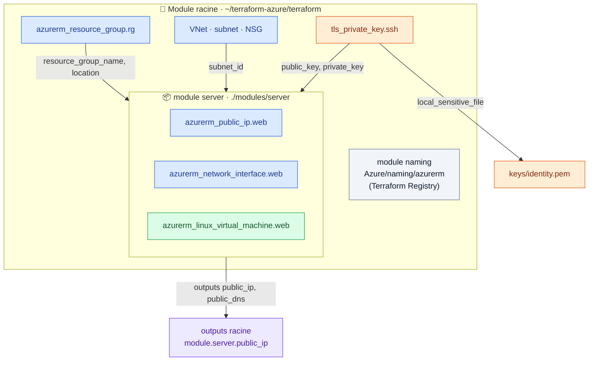

# 🟪 Lab 05 — Les modules

   

## 🎯 Objectifs

À la fin de ce lab, vous serez capable de :

- ✅ **refactoriser** l'IP publique, la carte réseau et la VM dans un module local `server` ;
- ✅ **passer** des valeurs de la racine vers le module (variables) et du module vers la racine (outputs) ;
- ✅ **déplacer** des ressources dans un module **sans les recréer** grâce aux blocs `moved` ;
- ✅ **consommer** un module public du Terraform Registry (`Azure/naming/azurerm`) ;
- ✅ **générer** une paire de clés SSH avec le provider `tls` et **expliquer** pourquoi la VM est recréée.

## 📋 Prérequis

Lab 04 terminé : `terraform plan` affiche `No changes`.

## 🗺️ Architecture



> [!NOTE]
> Un module est simplement **un répertoire de fichiers `.tf`**. Le répertoire où l'on lance `terraform` est le **module racine**. Un module ne voit **rien** de la racine : tout doit lui être passé par ses variables.

---

## Étape 1 — Refactoriser le serveur dans un module local

### 1.1 L'arborescence

```bash
cd ~/terraform-azure/terraform
mkdir -p modules/server
touch modules/server/{versions.tf,main.tf,variables.tf,outputs.tf}
```

```text
terraform/
├── providers.tf  main.tf  variables.tf  outputs.tf  terraform.tfvars
└── modules/
    └── server/
        ├── versions.tf    ← providers requis par le module
        ├── variables.tf   ← ENTRÉES du module
        ├── main.tf        ← ressources
        └── outputs.tf     ← SORTIES du module
```

### 1.2 Les providers requis par le module

`modules/server/versions.tf` :

```hcl
terraform {
  required_version = ">= 1.9"

  required_providers {
    azurerm = {
      source  = "hashicorp/azurerm"
      version = "~> 4.0"
    }
  }
}
```

> [!TIP]
> Pas de bloc `provider` dans un module : il **hérite** du provider configuré à la racine.

### 1.3 Les entrées du module

`modules/server/variables.tf` :

```hcl
variable "identity" {
  type = string
}

variable "location" {
  type = string
}

variable "resource_group_name" {
  type = string
}

variable "subnet_id" {
  type = string
}

variable "vm_size" {
  type    = string
  default = "Standard_B1s"
}

variable "admin_username" {
  type    = string
  default = "azureuser"
}

variable "public_key" {
  description = "Clé publique SSH au format OpenSSH"
  type        = string
}

variable "tags" {
  type    = map(string)
  default = {}
}
```

### 1.4 Les ressources du module

**Coupez** `azurerm_public_ip.web`, `azurerm_network_interface.web` et `azurerm_linux_virtual_machine.web` de `main.tf` (racine) et **collez-les** dans `modules/server/main.tf`. Remplacez ensuite chaque référence à la racine par une variable :

```diff
 resource "azurerm_public_ip" "web" {
   name                = "pip-web"
-  location            = azurerm_resource_group.rg.location
-  resource_group_name = azurerm_resource_group.rg.name
+  location            = var.location
+  resource_group_name = var.resource_group_name
```

```diff
   ip_configuration {
     name                          = "internal"
-    subnet_id                     = azurerm_subnet.web.id
+    subnet_id                     = var.subnet_id
```

```diff
   admin_ssh_key {
     username   = var.admin_username
-    public_key = file("~/.ssh/id_rsa.pub")
+    public_key = var.public_key
   }
```

✏️ **TODO 1** — Faites de même pour `location` et `resource_group_name` de la NIC et de la VM. `var.identity`, `var.vm_size`, `var.admin_username` et `var.tags` existent aussi dans le module : rien à changer pour eux.

### 1.5 Les sorties du module

`modules/server/outputs.tf` :

```hcl
output "public_ip" {
  value = azurerm_public_ip.web.ip_address
}

output "public_dns" {
  value = azurerm_public_ip.web.fqdn
}

output "private_ip" {
  value = ____   # ✏️ TODO 2
}
```

### 1.6 Appeler le module depuis la racine

Dans `main.tf` (racine), à la place des trois ressources :

```hcl
module "server" {
  source = "./modules/server"

  # nom_de_variable_du_module = valeur venant de la racine
  identity            = var.identity
  location            = azurerm_resource_group.rg.location
  resource_group_name = azurerm_resource_group.rg.name
  subnet_id           = ____   # ✏️ TODO 3
  vm_size             = var.vm_size
  admin_username      = var.admin_username
  public_key          = file("~/.ssh/id_rsa.pub")
  tags                = var.tags
}
```

✏️ **TODO 4** — Dans `outputs.tf` (racine), faites lire les 4 outputs dans le module : `module.server.<output>`.

### 1.7 🔍 Observer : le plan **sans** `moved`

```bash
terraform init      # obligatoire, même pour un module local
terraform plan
```

```text
  # azurerm_linux_virtual_machine.web will be destroyed
  # module.server.azurerm_linux_virtual_machine.web will be created
  ...
Plan: 3 to add, 0 to change, 3 to destroy.
```

> [!CAUTION]
> **N'appliquez pas !** Pour Terraform, une nouvelle **adresse** = une nouvelle ressource. Il détruirait la VM pour en créer une identique.

### 1.8 Déplacer sans recréer avec `moved`

Ajoutez dans `main.tf` (racine) :

```hcl
moved {
  from = azurerm_public_ip.web
  to   = module.server.azurerm_public_ip.web
}

moved {
  from = ____   # ✏️ TODO 5 : la carte réseau
  to   = ____
}

moved {
  from = azurerm_linux_virtual_machine.web
  to   = module.server.azurerm_linux_virtual_machine.web
}
```

```bash
terraform plan
```

```text
  # azurerm_linux_virtual_machine.web has moved to module.server.azurerm_linux_virtual_machine.web
    resource "azurerm_linux_virtual_machine" "web" { ... }

Plan: 0 to add, 0 to change, 0 to destroy.
```

```bash
terraform apply
terraform state list     # les ressources sont préfixées par module.server.
```

> [!IMPORTANT]
> Les blocs `moved` (Terraform ≥ 1.1) remplacent `terraform state mv` : le déplacement est **versionné avec le code** et s'applique à tous les environnements. On les supprime quand tous les états ont été migrés.

---

## Étape 2 — Le registre public des modules

### 2.1 Explorer

Ouvrez <https://registry.terraform.io/>, filtrez sur le provider **azurerm** et repérez :

- 🟦 les **Azure Verified Modules** (`Azure/avm-res-…`), maintenus par Microsoft ;
- 🟩 **`Azure/naming/azurerm`**, qui calcule des noms conformes aux règles Azure (longueur, caractères, unicité).

Pour chaque module : onglets **Readme**, **Inputs**, **Outputs**, **Resources**.

### 2.2 Utiliser le module `naming`

Dans `main.tf` :

```hcl
module "naming" {
  source  = "Azure/naming/azurerm"
  version = "~> 0.4"   # toujours épingler la version d'un module public

  suffix = [var.identity]
}
```

Dans `outputs.tf` :

```hcl
output "noms_recommandes" {
  value = {
    resource_group  = module.naming.resource_group.name
    virtual_network = module.naming.virtual_network.name
    storage_account = module.naming.storage_account.name_unique
  }
}
```

```bash
terraform init      # télécharge le module dans .terraform/modules
terraform apply
```

### 🔍 Observer

✏️ **TODO 6** — Le plan annonce quelques ressources à créer. Lesquelles ? Sont-elles visibles dans le portail Azure ?

> [!WARNING]
> N'utilisez pas ces noms pour renommer vos ressources existantes : un changement de `name` force leur recréation. Le module sert pour les **nouveaux** projets.

---

## Étape 3 — Générer une clé SSH et la passer au module

### 3.1 Déclarer les providers

Dans `providers.tf`, complétez `required_providers` :

```diff
     azurerm = {
       source  = "hashicorp/azurerm"
       version = "~> 4.0"
     }
+    tls = {
+      source  = "hashicorp/tls"
+      version = "~> 4.0"
+    }
+    local = {
+      source  = "hashicorp/local"
+      version = "~> 2.5"
+    }
```

### 3.2 Générer la clé

Dans `main.tf` :

```hcl
resource "tls_private_key" "ssh" {
  algorithm = "RSA"
  rsa_bits  = 4096
}

resource "local_sensitive_file" "private_key" {
  content         = tls_private_key.ssh.private_key_pem
  filename        = "${path.root}/keys/${var.identity}.pem"
  file_permission = "0600"
}
```

> [!CAUTION]
> La clé privée est stockée **en clair dans le fichier d'état**. Pratique en formation, **interdit en production** (on préfère une clé générée hors de Terraform ou Azure Key Vault). Vérifiez que `keys/` est dans le `.gitignore`.

### 3.3 Passer la clé au module

Dans `modules/server/variables.tf` :

```hcl
variable "private_key" {
  description = "Clé privée SSH, utilisée par les provisioners au lab 06"
  type        = string
  sensitive   = true
}
```

Dans l'appel du module :

```diff
 module "server" {
   ...
-  public_key          = file("~/.ssh/id_rsa.pub")
+  public_key          = tls_private_key.ssh.public_key_openssh
+  private_key         = tls_private_key.ssh.private_key_pem
   tags                = var.tags
 }
```

✏️ **TODO 7** — Mettez à jour l'output `ssh_command` pour qu'il utilise `-i keys/${var.identity}.pem`.

---

## Étape 4 — Appliquer et observer

```bash
terraform init
terraform plan
```

### 🔍 Observer

✏️ **TODO 8** — Quelle ressource est marquée `-/+` ? Quel attribut porte `# forces replacement` ? Notez le résumé du plan.

```bash
terraform apply
$(terraform output -raw ssh_command)
```

---

## ✅ Vérification

- [ ] `terraform state list | grep module.server` affiche 3 ressources.
- [ ] Le refactoring avec `moved` s'est fait avec **0 to destroy**.
- [ ] La connexion SSH fonctionne avec `keys/<identity>.pem`.
- [ ] `git status` (si dépôt) ne montre ni `keys/` ni `*.tfstate`.

## 🧯 Si vous voyez…

| Message | Cause | Solution |
|---|---|---|
| `Module not installed` | module ajouté sans `init` | `terraform init` |
| `Unsupported argument "xxx"` dans `module "server"` | argument sans `variable` correspondante dans le module | déclarez-la dans `modules/server/variables.tf` |
| `Reference to undeclared resource azurerm_subnet.web` (dans le module) | le module ne voit pas la racine | passez la valeur par une variable |
| `Moved object still exists` | ressource encore présente à l'ancienne adresse dans le code | supprimez l'ancien bloc `resource` de la racine |
| `Permission denied (publickey)` | ancienne clé utilisée | `ssh -i keys/<identity>.pem …` |

## 🏆 Défi

Ajoutez au module une variable `name_suffix` (défaut `"web"`) utilisée dans les noms `pip-${var.name_suffix}`, `nic-…`, `vm-…`. Avec la valeur par défaut, le plan doit afficher **No changes**. Pourquoi ?

## ❓ Questions de compréhension

1. Pourquoi faut-il relancer `terraform init` après avoir ajouté un module local ?
2. Comment une valeur passe-t-elle d'un module A à un module B ?
3. Quelle différence entre `moved` et `terraform state mv` ?
4. Pourquoi changer la clé publique recrée-t-il la VM ?
