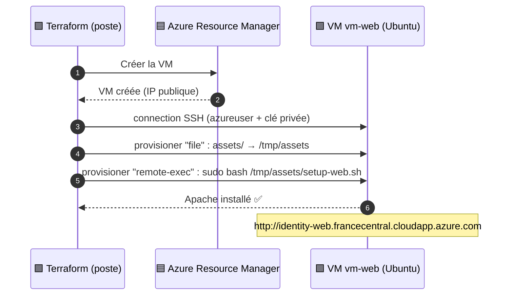

# 🟩 Lab 06 — Provisioners et cloud-init

   

## 🎯 Objectifs

À la fin de ce lab, vous serez capable de :

- ✅ **définir** un bloc `connection` SSH à partir de la clé générée au lab 05 ;
- ✅ **copier** des fichiers (`file`) et **exécuter** des commandes (`remote-exec`) sur la VM ;
- ✅ **expliquer** pourquoi un provisioner ne s'exécute **qu'à la création** et **forcer** sa ré-exécution avec `-replace` ;
- ✅ **comparer** les provisioners avec `custom_data` (cloud-init), l'approche recommandée sur Azure.

## 📋 Prérequis

Lab 05 terminé (module `server`, clé `keys/<identity>.pem`).

## 🗺️ Architecture



---

## Étape 1 — Le bloc de connexion

Dans `modules/server/main.tf`, à la fin de la ressource `azurerm_linux_virtual_machine.web` :

```hcl
resource "azurerm_linux_virtual_machine" "web" {
  # ... début du bloc inchangé ...

  connection {
    type        = "ssh"
    user        = var.admin_username
    private_key = ____   # ✏️ TODO 1 : la variable créée au lab 05
    host        = self.public_ip_address
  }
}
```

> [!NOTE]
> `self` désigne la ressource en cours de définition : `self.public_ip_address` est l'IP publique de **cette** VM. On ne peut pas écrire `azurerm_linux_virtual_machine.web.public_ip_address` à l'intérieur d'elle-même (cycle).

---

## Étape 2 — Copier et exécuter un script

### 2.1 Le script

Créez `assets/setup-web.sh` **à la racine** du projet :

```bash
#!/bin/bash
set -e
apt-get update
apt-get install -y apache2
systemctl enable --now apache2
echo "<html><h1>Bienvenue sur Apache, déployé par Terraform sur Azure</h1><p>$(hostname)</p></html>" > /var/www/html/index.html
```

### 2.2 Les provisioners

Ajoutez **dans** la ressource VM, après `connection` :

```hcl
  provisioner "file" {
    source      = "${path.root}/assets"
    destination = "/tmp/"
  }

  provisioner "remote-exec" {
    inline = [
      "cloud-init status --wait > /dev/null",   # attendre la fin du démarrage (verrou apt)
      "____",                                    # ✏️ TODO 2 : exécuter le script avec sudo
    ]
  }
```

> [!TIP]
> `path.root` = répertoire du module racine ; `path.module` = répertoire du module courant. Ici, `assets/` est à la racine.

---

## Étape 3 — Appliquer et observer

### 3.1 🔍 Observer : les provisioners ne déclenchent rien seuls

```bash
terraform apply
```

✏️ **TODO 3** — Notez le résumé. Pourquoi la VM n'est-elle pas recréée ?

### 3.2 Forcer la recréation

`terraform taint` est déprécié : on utilise `-replace`.

```bash
terraform plan  -replace="module.server.azurerm_linux_virtual_machine.web"   # prévisualiser
terraform apply -replace="module.server.azurerm_linux_virtual_machine.web"
```

```text
module.server.azurerm_linux_virtual_machine.web: Provisioning with 'file'...
module.server.azurerm_linux_virtual_machine.web: Provisioning with 'remote-exec'...
module.server.azurerm_linux_virtual_machine.web (remote-exec): Connecting to remote host via SSH...
module.server.azurerm_linux_virtual_machine.web (remote-exec):   Host: 20.x.x.x
module.server.azurerm_linux_virtual_machine.web (remote-exec):   User: azureuser
module.server.azurerm_linux_virtual_machine.web (remote-exec): Connected!
...
Apply complete! Resources: 1 added, 0 changed, 1 destroyed.
```

### 3.3 Tester

Ajoutez dans `outputs.tf` (racine) :

```hcl
output "url" {
  value = "http://${module.server.public_dns}"
}
```

```bash
terraform apply
curl $(terraform output -raw url)
```

> [!WARNING]
> Si un provisioner **échoue**, la ressource est marquée **tainted** : elle sera **recréée** au prochain `apply`.

---

## Exercice — Provisioning avec une clé fournie et Nginx

Travaillez dans `~/terraform-azure/lab04-exercice`.

1. Générez une paire de clés : `ssh-keygen -t rsa -b 4096 -f mykey -N ""` (ajoutez `mykey*` au `.gitignore`).
2. Ajoutez dans `variables.tf` : `path_to_private_key` (défaut `"mykey"`), `path_to_public_key` (défaut `"mykey.pub"`), `instance_username` (défaut `"azureuser"`).
3. Dans la VM, utilisez `file(var.path_to_public_key)` dans `admin_ssh_key`.
4. Créez `script.sh` :

```bash
#!/bin/bash
until [[ -f /var/lib/cloud/instance/boot-finished ]]; do sleep 1; done
apt-get update
apt-get -y install nginx
systemctl enable --now nginx
```

5. ✏️ **TODO 4** — Écrivez vous-même le bloc `connection` et les deux provisioners (`file` vers `/tmp/script.sh`, puis `remote-exec`). Pensez aux fins de ligne Windows : `sed -i -e 's/\\r$//' /tmp/script.sh`.
6. Appliquez (la VM existe déjà : que faut-il faire ?), puis ouvrez `http://<IP>`.

---

## Pour aller plus loin — `custom_data` (cloud-init)

HashiCorp recommande les provisioners **en dernier recours**. Sur Azure, on passe plutôt le script **au démarrage** :

```hcl
resource "azurerm_linux_virtual_machine" "web" {
  # ...
  custom_data = base64encode(file("${path.root}/assets/setup-web.sh"))
}
```

| | 🟧 Provisioners | 🟩 `custom_data` / cloud-init |
|---|---|---|
| Connexion SSH depuis Terraform | obligatoire | non |
| Port 22 ouvert pour Terraform | oui | non |
| Erreurs visibles dans Terraform | oui | non (`/var/log/cloud-init-output.log`) |
| Modifier le script | rien ne se passe (sauf `-replace`) | 🟥 `-/+` : `custom_data` force la recréation |
| Recommandé en production | non | oui |

---

## ✅ Vérification

- [ ] `curl $(terraform output -raw url)` affiche la page Apache avec le nom d'hôte.
- [ ] Vous savez expliquer pourquoi l'ajout d'un provisioner ne recrée pas la VM.
- [ ] Exercice : la page Nginx s'affiche.

## 🧯 Si vous voyez…

| Message | Cause | Solution |
|---|---|---|
| `timeout - last error: dial tcp …:22: i/o timeout` | NSG : votre IP a changé | `curl -s ifconfig.me`, mettez à jour `allowed_ssh_cidr` |
| `ssh: handshake failed: ssh: unable to authenticate` | mauvaise clé dans `connection` | la clé privée doit correspondre à `admin_ssh_key` |
| `Could not get lock /var/lib/dpkg/lock-frontend` | cloud-init utilise encore apt | gardez `cloud-init status --wait` |
| `/bin/bash^M: bad interpreter` | script édité sous Windows (CRLF) | `sed -i 's/\r$//'` ou VS Code → LF |
| Ressource `tainted` après une erreur | le provisioner a échoué | corrigez puis `terraform apply` (recréation) |

## 🏆 Défi

Remplacez les provisioners du fil rouge par `custom_data`. Que montre le plan ? Une fois appliqué, comment vérifier que le script s'est bien exécuté ?

## ❓ Questions de compréhension

1. Pourquoi `self` est-il obligatoire dans `connection.host` ?
2. Que devient une VM dont le provisioner échoue ?
3. Citez deux raisons de préférer `custom_data` aux provisioners.
