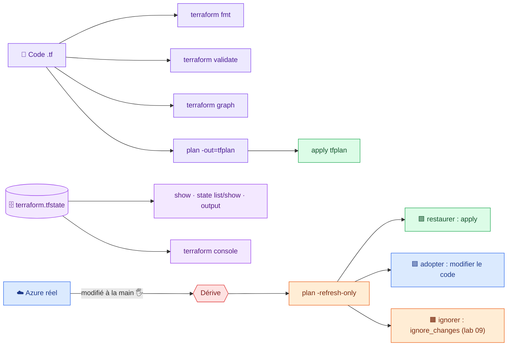

# 🟪 Lab 07 — Commandes Terraform, dérive (drift) et plan enregistré

   

## 🎯 Objectifs

À la fin de ce lab, vous serez capable de :

- ✅ **évaluer** des expressions et tester des fonctions avec `terraform console` ;
- ✅ **visualiser** le graphe de dépendances avec `terraform graph` ;
- ✅ **inspecter** l'état avec `show`, `state list`, `state show` et `output` ;
- ✅ **détecter** une modification faite hors de Terraform (**dérive**), la **lire** avec `plan -refresh-only` et **choisir** entre restaurer, adopter ou ignorer ;
- ✅ **enregistrer** un plan (`plan -out`) et **appliquer exactement** ce plan ;
- ✅ **garder** un code propre avec `fmt` et `validate`.

## 📋 Prérequis

Lab 06 terminé : le serveur web répond.

## 🗺️ Architecture



---

## Étape 1 — La console

```bash
cd ~/terraform-azure/terraform
terraform console
```

```text
> azurerm_resource_group.rg.location
"francecentral"
> module.server.public_ip
"20.x.x.x"
> azurerm_subnet.web.address_prefixes
tolist([
  "10.0.1.0/24",
])
> cidrsubnet("10.0.0.0/16", 8, 2)
"10.0.2.0/24"
> upper(var.identity)
"STUDENT01"
> merge(var.tags, { Name = "Web" })
```

✏️ **TODO 1** — Dans la console, calculez les **trois** premiers sous-réseaux `/24` de `10.0.0.0/16` en **une seule** expression (indice : `[for i in range(…) : …]`).

Quittez avec `exit`. Mode non interactif :

```bash
echo 'module.server.public_dns' | terraform console
```

---

## Étape 2 — Le graphe de dépendances

```bash
terraform graph > graph.dot
sudo apt-get install -y graphviz && dot -Tsvg graph.dot > graph.svg   # ou https://dreampuf.github.io/GraphvizOnline/
```

✏️ **TODO 2** — Retrouvez dans le graphe la chaîne : groupe de ressources → ____ → ____ → module `server` (NIC → VM).

---

## Étape 3 — Lire l'état

```bash
terraform show | less
terraform state list
terraform state show module.server.azurerm_linux_virtual_machine.web
terraform output -json | jq
```

> [!CAUTION]
> Ne modifiez **jamais** `terraform.tfstate` à la main. Pour retirer ou déplacer une ressource : blocs `removed` / `moved`, ou `terraform state rm` / `state mv` en dernier recours.

---

## Étape 4 — 🔥 La dérive (drift)

Un collègue modifie l'infrastructure **sans passer par Terraform**. Simulez-le :

```bash
RG="rg-$(terraform console <<< 'var.identity' | tr -d '"')-lab"

# 1. Un tag ajouté "à la main" sur la VM
az vm update -g "$RG" -n vm-web --set tags.Owner=collegue -o none

# 2. Une règle NSG supprimée "à la main"
az network nsg rule delete -g "$RG" --nsg-name nsg-web -n Allow-HTTP
curl -m 5 $(terraform output -raw url)     # le site ne répond plus 😱
```

### 4.1 🔍 Observer : ce que voit `plan`

```bash
terraform plan
```

```text
Note: Objects have changed outside of Terraform

Terraform detected the following changes made outside of Terraform since the
last "terraform apply" which may have affected this plan:

  # module.server.azurerm_linux_virtual_machine.web has changed
  ~ resource "azurerm_linux_virtual_machine" "web" {
      ~ tags = {
          + "Owner" = "collegue"
        }
    }
  # azurerm_network_security_group.web has changed
  ...
```

✏️ **TODO 3** — Puis, sous `Terraform will perform the following actions`, que propose Terraform pour **chacune** des deux modifications ? Notez le résumé.

### 4.2 Lire la dérive seule : `-refresh-only`

```bash
terraform plan -refresh-only     # montre UNIQUEMENT la dérive, ne propose aucune action
```

| Commande | Compare | Écrit l'état ? | Modifie Azure ? |
|---|---|---|---|
| `terraform plan` | code ⟷ réalité | non | non |
| `terraform plan -refresh-only` | état ⟷ réalité | non | non |
| `terraform apply -refresh-only` | état ⟷ réalité | 🟪 **oui** | non |
| `terraform apply` | code ⟷ réalité | oui | 🟥 **oui** |

### 4.3 Décider

| Décision | Quand | Action |
|---|---|---|
| 🟩 **Restaurer** | la modification manuelle est une erreur | `terraform apply` |
| 🟦 **Adopter** | la modification doit être conservée | l'écrire dans le code, puis `plan` → `No changes` |
| 🟧 **Ignorer** | l'attribut est géré par quelqu'un d'autre | `lifecycle { ignore_changes = [...] }` (lab 09) |

✏️ **TODO 4** — Ici, la règle HTTP supprimée est une erreur : **restaurez-la**. Le tag `Owner` est légitime : **adoptez-le** pour la VM uniquement.

<details>
<summary>💡 Indice pour adopter le tag</summary>

Dans l'appel du module : `tags = merge(var.tags, { Owner = "collegue" })`. Pourquoi ce tag n'apparaîtra-t-il pas sur le groupe de ressources ?

</details>

```bash
terraform apply
terraform plan                          # ✅ No changes
curl $(terraform output -raw url)       # ✅ le site répond
```

> [!IMPORTANT]
> `terraform apply -refresh-only` **accepte** la dérive dans l'état, mais **ne change pas le code** : au `plan` suivant, Terraform proposera à nouveau de revenir à ce que dit le code.

---

## Étape 5 — Le plan enregistré

En équipe et en CI/CD, on **relit** un plan, puis on applique **exactement** ce plan.

```bash
terraform plan -var="vm_size=Standard_B1ms" -out=tfplan
terraform show tfplan            # relecture (format lisible)
terraform show -json tfplan | jq '.resource_changes[] | {adresse: .address, actions: .change.actions}'
```

### 🔍 Observer : un plan devenu obsolète

Dans **un second terminal** (même répertoire, `source ~/.azure-tf.env`), modifiez l'état :

```bash
terraform apply -auto-approve -var='tags={Environment="Training", Demo="stale"}'   # change les tags → nouvel état (serial +1)
```

Revenez au premier terminal :

```bash
terraform apply tfplan
```

✏️ **TODO 5** — Quel message obtenez-vous ? Pourquoi est-ce une protection ?

```bash
rm tfplan             # tfplan est dans le .gitignore : il peut contenir des valeurs sensibles
terraform apply       # retire le tag Demo : retour à la configuration du code
```

---

## Étape 6 — Reconstruire une ressource

```bash
terraform plan -replace="module.server.azurerm_linux_virtual_machine.web"
terraform plan -replace="azurerm_linux_virtual_machine.web"    # adresse fausse : que se passe-t-il ?
```

> [!NOTE]
> `terraform taint` existe toujours mais est **déprécié** : `-replace` montre l'effet **dans le plan** avant d'agir et ne modifie pas l'état à l'avance.

---

## Étape 7 — Formater et valider

```bash
terraform fmt -recursive          # réécrit au format canonique
terraform fmt -check -recursive   # en CI : code retour ≠ 0 si mal formaté
terraform validate
```

---

## ✅ Vérification

- [ ] Vous savez retrouver l'IP de la VM de trois façons (`console`, `state show`, `output`).
- [ ] Après la dérive, `terraform plan` affiche `No changes` et le site répond.
- [ ] Le tag `Owner = collegue` est présent sur la VM **et** dans le code.
- [ ] `terraform fmt -check -recursive` et `terraform validate` passent.

## 🧯 Si vous voyez…

| Message | Cause | Solution |
|---|---|---|
| `Saved plan is stale` | l'état a changé depuis le `plan -out` | refaites `plan -out` |
| `Error acquiring the state lock` | une autre commande tourne sur ce state | attendez la fin de l'autre terminal |
| `Warning: Resource targeting is in effect` | `-target` / `-replace` partiel | normal ; ne pas en faire une habitude |
| `Invalid character` dans la console | guillemets typographiques copiés | retapez `"` au clavier |

## 🏆 Défi

Supprimez **à la main** l'association NSG ↔ subnet (`az network vnet subnet update -g "$RG" --vnet-name vnet-<identity> -n snet-web --nsg ""`). Que propose `terraform plan` ? Et `terraform plan -refresh-only` ?

## ❓ Questions de compréhension

1. Quelle différence entre `terraform plan` et `terraform plan -refresh-only` ?
2. Après un `apply -refresh-only`, pourquoi le `plan` suivant propose-t-il encore des changements ?
3. Pourquoi applique-t-on un **fichier de plan** plutôt qu'un nouveau `apply` en CI/CD ?
4. Que fait `terraform fmt -check` et pourquoi l'utiliser en CI ?
