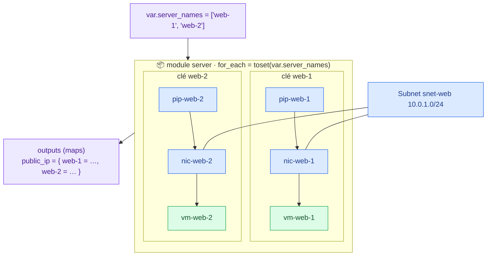

# 🟧 Lab 08 — Les méta‑arguments `count` et `for_each`

   

## 🎯 Objectifs

À la fin de ce lab, vous serez capable de :

- ✅ **créer** plusieurs serveurs identiques avec `count` et **référencer** toutes les instances avec le splat `[*]` ;
- ✅ **démontrer** le piège de `count` (décalage des index) ;
- ✅ **migrer** de `count` vers `for_each` **sans recréation** grâce à des blocs `moved` ;
- ✅ **supprimer** un serveur précis avec `for_each` sans toucher aux autres ;
- ✅ **générer** des blocs imbriqués avec `dynamic`.

## 📋 Prérequis

Lab 07 terminé : `terraform plan` affiche `No changes`.

> [!WARNING]
> **Quota :** ce lab monte jusqu'à **3 VM par stagiaire**. Ne dépassez pas 3, et revenez à 2 à la fin.

## 🗺️ Architecture



---

## Étape 0 — Faire le ménage des `moved` du lab 05

Les trois blocs `moved` du lab 05 ont été appliqués : supprimez-les de `main.tf` (racine).

```bash
terraform plan    # ✅ No changes : les blocs moved ne servaient plus
```

> [!TIP]
> On supprime un bloc `moved` **une fois que tous les états** (tous les environnements, tous les collègues) l'ont appliqué.

---

## Étape 1 — Plusieurs serveurs avec `count`

Sur Azure, chaque VM a besoin de **sa propre** carte réseau et de **sa propre** IP publique : `count` s'applique aux **trois** ressources du module.

### 1.1 La variable

Dans `modules/server/variables.tf` :

```hcl
variable "num_webs" {
  description = "Nombre de serveurs web"
  type        = number
  default     = 2
}
```

### 1.2 `count` sur les ressources

Dans `modules/server/main.tf` :

```diff
 resource "azurerm_public_ip" "web" {
+  count               = var.num_webs
-  name                = "pip-web"
+  name                = "pip-web-${count.index + 1}"
   ...
-  domain_name_label   = "${var.identity}-web"
+  domain_name_label   = "${var.identity}-web-${count.index + 1}"
 }

 resource "azurerm_network_interface" "web" {
+  count               = var.num_webs
-  name                = "nic-web"
+  name                = "nic-web-${count.index + 1}"
   ...
-    public_ip_address_id          = azurerm_public_ip.web.id
+    public_ip_address_id          = azurerm_public_ip.web[count.index].id
 }

 resource "azurerm_linux_virtual_machine" "web" {
+  count                 = var.num_webs
-  name                  = "vm-web"
+  name                  = "vm-web-${count.index + 1}"
   ...
-  network_interface_ids = [azurerm_network_interface.web.id]
+  network_interface_ids = [____]   # ✏️ TODO 1
   ...
   tags = merge(var.tags, {
     Identity = var.identity
-    Name     = "Web"
+    Name     = "web-${count.index + 1}"
   })
 }
```

> [!NOTE]
> `count.index` commence à **0**, d'où le `+ 1`. `self` fonctionne toujours dans `connection` et les provisioners.

---

## Étape 2 — Adapter les outputs

### 2.1 🔍 Observer l'erreur

```bash
terraform plan
```

```text
Error: Missing resource instance key
  on modules/server/outputs.tf line 2, in output "public_ip":
   2:   value = azurerm_public_ip.web.ip_address
Because azurerm_public_ip.web has "count" set, its attributes must be accessed on specific instances.
```

Avec `count`, la ressource devient **une liste** de ressources.

### 2.2 L'opérateur splat

`modules/server/outputs.tf` :

```hcl
output "public_ip" {
  value = azurerm_public_ip.web[*].ip_address
}

output "public_dns" {
  value = azurerm_public_ip.web[*].fqdn
}

output "private_ip" {
  value = ____   # ✏️ TODO 2
}
```

✏️ **TODO 3** — Dans `outputs.tf` (racine), `ssh_command` et `url` ne fonctionnent plus. Remplacez-les par :

- `ssh_command` : la commande pour le **premier** serveur (index `[0]`) ;
- `urls` : une **liste** d'URL, avec une expression `[for d in module.server.public_dns : "http://${d}"]`.

### 2.3 🔍 Observer le plan

```bash
terraform plan
```

✏️ **TODO 4** — Notez le résumé. Pourquoi l'ancienne VM est-elle **détruite** alors que Terraform l'a automatiquement renumérotée `[0]` ?

```bash
terraform apply      # ~5 min : 2 VM + provisioners
terraform output urls
```

Ouvrez les deux URL : chaque page affiche un **nom d'hôte différent**.

---

## Étape 3 — Piloter le nombre depuis la racine

```diff
 module "server" {
   source   = "./modules/server"
+  num_webs = 3
   ...
```

```bash
terraform plan     # ✏️ TODO 5 : résumé ?
```

N'appliquez pas. Remettez `num_webs = 2`.

### 🔍 Observer : le piège de `count`

Vous voulez supprimer **uniquement `vm-web-1`** et garder `vm-web-2`. Avec `count`, la seule option est `num_webs = 1` : mettez temporairement `num_webs = 1` dans l'appel du module, puis :

```bash
terraform plan
```

✏️ **TODO 6** — Quelle VM Terraform détruit-il ? Pourquoi ne peut-on pas choisir ? Remettez `num_webs = 2` sans appliquer.

> [!WARNING]
> Avec `count`, retirer un élément **au milieu** d'une liste décale tous les index suivants : les ressources concernées sont **recréées**.

---

## Étape 4 — Migrer vers `for_each` sans rien recréer

### 4.1 Remplacer `count` par `for_each`

Dans `modules/server/variables.tf`, remplacez `num_webs` par :

```hcl
variable "server_names" {
  description = "Clés des serveurs à créer (une VM par clé)"
  type        = list(string)
  default     = ["web-1", "web-2"]

  validation {
    condition     = length(var.server_names) <= 3
    error_message = "3 serveurs maximum (quota vCPU de la formation)."
  }
}
```

Dans `modules/server/main.tf`, sur les trois ressources :

```diff
-  count               = var.num_webs
-  name                = "pip-web-${count.index + 1}"
+  for_each            = toset(var.server_names)
+  name                = "pip-${each.key}"
```

✏️ **TODO 7** — Faites de même pour la NIC et la VM, en remplaçant `[count.index]` par `[each.key]`, `"${var.identity}-web-${count.index + 1}"` par `"${var.identity}-${each.key}"` et le tag `Name` par `each.key`.

> [!IMPORTANT]
> Les **noms Azure** obtenus sont **identiques** (`vm-web-1`, `vm-web-2`…). Seule change l'**adresse Terraform** : `…web[0]` devient `…web["web-1"]`.

Outputs du module : avec `for_each`, la ressource devient une **map**.

```hcl
output "public_ip" {
  value = { for k, p in azurerm_public_ip.web : k => p.ip_address }
}

output "public_dns" {
  value = { for k, p in azurerm_public_ip.web : k => p.fqdn }
}

output "private_ip" {
  value = { for k, vm in azurerm_linux_virtual_machine.web : k => vm.private_ip_address }
}
```

Racine : supprimez `num_webs` de l'appel du module, et adaptez les outputs :

```hcl
output "ssh_commands" {
  value = { for k, ip in module.server.public_ip : k => "ssh -i keys/${var.identity}.pem ${var.admin_username}@${ip}" }
}

output "urls" {
  value = [for d in values(module.server.public_dns) : "http://${d}"]
}
```

### 4.2 🔍 Observer **sans** `moved`

```bash
terraform plan
```

✏️ **TODO 8** — Résumé ? **N'appliquez pas.**

### 4.3 Les blocs `moved`

Créez `modules/server/moved.tf` :

```hcl
moved {
  from = azurerm_public_ip.web[0]
  to   = azurerm_public_ip.web["web-1"]
}

moved {
  from = azurerm_public_ip.web[1]
  to   = azurerm_public_ip.web["web-2"]
}

# ✏️ TODO 9 : les 4 blocs pour azurerm_network_interface.web et azurerm_linux_virtual_machine.web
```

```bash
terraform plan     # ✅ … has moved to …   Plan: 0 to add, 0 to change, 0 to destroy.
terraform apply
```

> [!NOTE]
> Les blocs `moved` sont écrits **dans le module**, avec des adresses relatives au module (sans `module.server.`).

### 4.4 Supprimer un serveur précis

Ajoutez dans `variables.tf` (racine) une variable `server_names` (même défaut) et passez-la au module : `server_names = var.server_names`.

```bash
terraform plan -var='server_names=["web-2"]'
```

✏️ **TODO 10** — Quelles ressources sont détruites ? Comparez avec le TODO 6. N'appliquez pas.

---

## 🏆 Défi — Règles NSG générées avec `dynamic`

`for_each` existe aussi pour les **blocs imbriqués** (`dynamic`). Remplacez les deux `security_rule` du NSG (racine) par :

```hcl
variable "inbound_rules" {
  type = map(object({
    port     = number
    priority = number
    source   = string
  }))
}
```

```hcl
  dynamic "security_rule" {
    for_each = var.inbound_rules
    content {
      name                       = "Allow-${security_rule.key}"
      priority                   = security_rule.value.priority
      direction                  = "Inbound"
      access                     = "Allow"
      protocol                   = "Tcp"
      source_port_range          = "*"
      destination_port_range     = tostring(security_rule.value.port)
      source_address_prefix      = security_rule.value.source
      destination_address_prefix = "*"
    }
  }
```

Écrivez la valeur de `inbound_rules` dans `terraform.tfvars` pour que `terraform plan` affiche **No changes**.

> [!TIP]
> Priorité **explicite** dans la map : calculer la priorité à partir de la position de la clé décalerait toutes les règles à chaque ajout.

---

## ✅ Vérification

- [ ] `terraform state list | grep 'web\["'` affiche 6 ressources (`web-1`, `web-2`).
- [ ] `terraform output urls` affiche 2 URL qui répondent.
- [ ] La migration `count` → `for_each` s'est faite avec **0 to destroy**.
- [ ] Vous savez expliquer pourquoi `for_each` évite le piège de `count`.

## 🧯 Si vous voyez…

| Message | Cause | Solution |
|---|---|---|
| `Missing resource instance key` | référence sans index sur une ressource `count`/`for_each` | `[count.index]`, `[each.key]` ou `[*]` |
| `The "for_each" set includes values derived from resource attributes that cannot be determined until apply` | clés calculées à l'apply | utilisez des clés connues au plan (chaînes fixes) |
| `Invalid for_each argument … list of string` | `for_each` sur une liste | `toset(var.server_names)` |
| `OperationNotAllowed … exceeding approved … cores` | quota vCPU atteint | revenez à 2 serveurs |

## ❓ Questions de compréhension

1. Pourquoi `count` est-il risqué pour une liste de ressources qui évolue ?
2. Pourquoi faut-il `toset()` avec une `list(string)` ?
3. Après la migration, quelle est l'adresse Terraform de la 2ᵉ VM ? Son nom Azure a-t-il changé ?
4. Quand préférer malgré tout `count` ? (indice : `count = var.create ? 1 : 0`)
