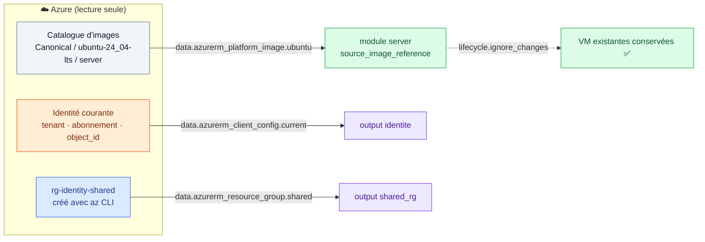

# 🟦 Lab 09 — Sources de données et cycle de vie (`lifecycle`)

   

## 🎯 Objectifs

À la fin de ce lab, vous serez capable de :

- ✅ **lire** des informations existantes dans Azure avec des blocs `data` (image, identité, groupe de ressources) ;
- ✅ **expliquer** pourquoi une image « la plus récente » lue dynamiquement peut **recréer** des VM à chaque publication ;
- ✅ **stabiliser** l'infrastructure avec `lifecycle { ignore_changes }` ;
- ✅ **protéger** une ressource avec `prevent_destroy` ;
- ✅ **choisir** la bonne option de `lifecycle` (`create_before_destroy`, `replace_triggered_by`…) selon la situation.

## 📋 Prérequis

Lab 08 terminé : 2 serveurs `web-1` et `web-2`.

## 🗺️ Architecture



> [!NOTE]
> **`resource`** : Terraform **crée et gère** l'objet (et le détruit au `destroy`).
> **`data`** : Terraform **lit** un objet existant, à chaque `plan`. Il ne le modifie jamais.

---

## Étape 1 — La source de données d'image

Dans `modules/server/main.tf`, en tête de fichier :

```hcl
data "azurerm_platform_image" "ubuntu" {
  location  = var.location
  publisher = "Canonical"
  offer     = "ubuntu-24_04-lts"
  sku       = "server"
}
```

Sans argument `version`, Azure renvoie **la version la plus récente** (comme `most_recent = true` sur AWS).

```bash
az vm image list --publisher Canonical --offer ubuntu-24_04-lts --sku server --all -o table | tail -5
```

Exposez la version lue : output `image_version` dans le module (`data.azurerm_platform_image.ubuntu.version`), puis à la racine (`module.server.image_version`).

---

## Étape 2 — Utiliser l'image renvoyée

Dans la VM :

```diff
   source_image_reference {
-    publisher = "Canonical"
-    offer     = "ubuntu-24_04-lts"
-    sku       = "server"
-    version   = "latest"
+    publisher = data.azurerm_platform_image.ubuntu.publisher
+    offer     = data.azurerm_platform_image.ubuntu.offer
+    sku       = data.azurerm_platform_image.ubuntu.sku
+    version   = data.azurerm_platform_image.ubuntu.version
   }
```

```bash
terraform plan
```

### 🔍 Observer

✏️ **TODO 1** — Notez le résumé et l'attribut marqué `# forces replacement`.

> [!CAUTION]
> **N'appliquez pas.** Réfléchissez : Canonical publie une nouvelle image Ubuntu **environ toutes les semaines**. À chaque publication, la source de données renvoie une nouvelle version… et chaque `terraform apply` **recréerait toutes vos VM**.

---

## Étape 3 — Stabiliser avec `ignore_changes`

```diff
   source_image_reference {
     ...
   }
+
+  lifecycle {
+    ignore_changes = [____]   # ✏️ TODO 2
+  }
```

```bash
terraform plan     # ✅ plus de recréation
terraform apply    # enregistre les nouveaux outputs
terraform output image_version
```

> [!IMPORTANT]
> Avec `ignore_changes`, les VM **existantes** gardent leur image ; les **nouvelles** VM (nouvelle clé dans `server_names`) partent de la dernière version. Pour mettre à jour une VM : `terraform apply -replace=…`.

---

## Étape 4 — Protéger une ressource avec `prevent_destroy`

Une IP publique statique est souvent déclarée dans un DNS ou chez un client : la perdre est grave. Ajoutez sur `azurerm_public_ip.web` (module) :

```hcl
  lifecycle {
    prevent_destroy = true
  }
```

```bash
terraform plan -var='server_names=["web-2"]'   # supprimer web-1 ?
terraform plan -destroy                         # tout détruire ?
```

✏️ **TODO 3** — Quel message obtenez-vous ? Le plan est-il calculé jusqu'au bout ?

> [!WARNING]
> **Retirez `prevent_destroy` maintenant** : sinon le `terraform destroy` de fin de journée échouera. En production, on le laisse sur les ressources critiques (bases de données, coffres, IP réservées).

---

## Étape 5 — Choisir la bonne option de `lifecycle`

| Option | Effet | Exemple d'usage |
|---|---|---|
| 🟧 `ignore_changes = [attr]` | ignore les différences sur ces attributs | image d'une VM, tags posés par une Azure Policy |
| 🟥 `prevent_destroy = true` | le plan **échoue** s'il implique une destruction | base de données, Key Vault |
| 🟩 `create_before_destroy = true` | crée la nouvelle ressource **avant** de détruire l'ancienne | certificat, IP, ressource derrière un load balancer |
| 🟦 `replace_triggered_by = [ref]` | recrée la ressource quand `ref` change | VM à recréer quand son script de configuration change |

✏️ **TODO 4** — Pour chaque situation, quelle option ?

| Situation | Option |
|---|---|
| Une Azure Policy ajoute le tag `CostCenter` sur toutes les ressources | ____ |
| On remplace un NSG utilisé en production, sans coupure | ____ |
| Le fichier `setup-web.sh` change : les VM doivent être reconstruites | ____ |
| Le compte de stockage des états Terraform | ____ |

> [!WARNING]
> `create_before_destroy` échoue si le **nom** doit être unique et ne change pas : Azure refuse deux ressources du même nom. On le combine avec un suffixe aléatoire.

---

## Étape 6 — Connaître l'identité courante

Dans `main.tf` (racine) :

```hcl
data "azurerm_client_config" "current" {}

output "identite" {
  value = {
    tenant_id       = data.azurerm_client_config.current.tenant_id
    subscription_id = data.azurerm_client_config.current.subscription_id
    object_id       = data.azurerm_client_config.current.object_id
  }
}
```

Cette source de données sera réutilisée au lab 13 pour attribuer un rôle RBAC.

---

## Étape 7 — Référencer une ressource existante

Créez un groupe **hors de Terraform** :

```bash
az group create --name rg-<identity>-shared --location francecentral --tags Owner=<identity> -o table
```

```hcl
data "azurerm_resource_group" "shared" {
  name = "rg-${var.identity}-shared"
}

output "shared_rg" {
  value = {
    id       = data.azurerm_resource_group.shared.id
    location = data.azurerm_resource_group.shared.location
    tags     = ____   # ✏️ TODO 5
  }
}
```

```bash
terraform apply
```

> [!IMPORTANT]
> **Ne supprimez pas** `rg-<identity>-shared` pour l'instant : le fil rouge le lit, et il servira au lab 12.

---

## ✅ Vérification

- [ ] `terraform output image_version` affiche une version du type `24.04.2026…`.
- [ ] `terraform plan` affiche `No changes` (aucune VM à recréer).
- [ ] `prevent_destroy` a été testé **puis retiré**.
- [ ] L'output `identite` affiche votre `object_id`, et `shared_rg` le tag `Owner`.

## 🧯 Si vous voyez…

| Message | Cause | Solution |
|---|---|---|
| `Instance cannot be destroyed` | `prevent_destroy` actif | retirez-le (c'est le but de l'étape 4) |
| `Resource Group "rg-…-shared" was not found` | groupe pas encore créé ou supprimé | `az group create …` |
| `A platform image with these criteria wasn't found` | offre/sku mal orthographiés | vérifiez avec `az vm image list` |
| VM recréées à chaque plan | `ignore_changes` absent ou mal placé | le bloc `lifecycle` doit être **dans** la ressource VM |

## 🏆 Défi — `replace_triggered_by`

Faites recréer automatiquement les VM quand `assets/setup-web.sh` change :

```hcl
resource "terraform_data" "script" {
  input = filesha256("${path.root}/assets/setup-web.sh")
}
```

Ajoutez `replace_triggered_by = [terraform_data.script]` dans le `lifecycle` de la VM, modifiez le message HTML du script, puis lancez `terraform plan`. Que voyez-vous ? (Annulez avant de continuer.)

## ❓ Questions de compréhension

1. Différence entre un bloc `resource` et un bloc `data` ?
2. Pourquoi `version = "latest"` ne provoquait-il **pas** de recréation, alors que la version lue par `data` en provoque ?
3. `terraform destroy` supprimera-t-il `rg-<identity>-shared` ? Pourquoi ?
4. Comment faire passer `rg-<identity>-shared` sous gestion Terraform ? (indice : bloc `import`)
