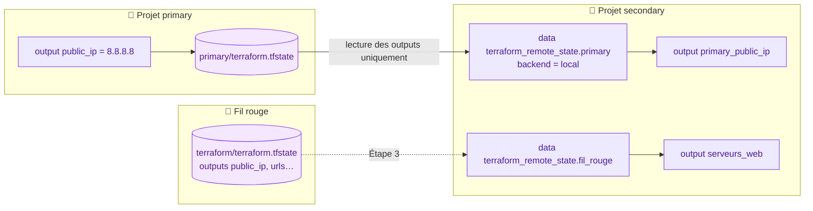

# 🟪 Lab 10 — Lire l'état d'un autre projet

  

## 🎯 Objectifs

À la fin de ce lab, vous serez capable de :

- ✅ **consommer** les outputs d'un autre projet avec `terraform_remote_state` ;
- ✅ **expliquer** pourquoi seuls les **outputs** sont accessibles (contrat d'interface) ;
- ✅ **lister** les limites d'un état local en équipe.

C'est la base des architectures **en couches** : l'équipe réseau publie le VNet, l'équipe applicative le consomme.

## 📋 Prérequis

Étapes 1 et 2 : **aucune** connexion à Azure. Étape 3 : fil rouge du lab 09 toujours déployé.

## 🗺️ Architecture



---

## Étape 1 — Un projet qui publie un output

```bash
mkdir -p ~/terraform-azure/lab10/primary && cd $_
```

`primary/main.tf` (c'est **tout** le fichier) :

```hcl
output "public_ip" {
  value = "8.8.8.8"
}
```

```bash
terraform init && terraform apply
ls terraform.tfstate
jq .outputs terraform.tfstate
```

---

## Étape 2 — Un projet qui lit cet état

```bash
mkdir -p ~/terraform-azure/lab10/secondary && cd $_
```

`secondary/main.tf` :

```hcl
data "terraform_remote_state" "primary" {
  backend = "local"

  config = {
    path = "____"   # ✏️ TODO 1 : chemin relatif vers l'état de primary
  }
}

output "primary_public_ip" {
  value = data.terraform_remote_state.primary.outputs.public_ip
}
```

```bash
terraform init && terraform apply
```

```text
Outputs:

primary_public_ip = "8.8.8.8"
```

> [!IMPORTANT]
> Seuls les **outputs** du projet source sont accessibles, jamais ses ressources internes. Les outputs sont un **contrat d'interface** entre équipes : on ne les renomme pas sans prévenir.

---

## Étape 3 — Lire l'état du fil rouge

Toujours dans `secondary/main.tf` :

```hcl
data "terraform_remote_state" "fil_rouge" {
  backend = "local"

  config = {
    path = "../../terraform/terraform.tfstate"
  }
}

output "serveurs_web" {
  value = {
    ips  = ____   # ✏️ TODO 2 : l'output public_ip du fil rouge
    urls = data.terraform_remote_state.fil_rouge.outputs.urls
  }
}
```

```bash
terraform apply
```

### 🔍 Observer

Vous obtenez les IP et les URL des serveurs **sans aucun accès à Azure** : seule la lecture du fichier d'état est nécessaire. Essayez : `unset ARM_CLIENT_SECRET && terraform apply`, puis `source ~/.azure-tf.env`.

> [!CAUTION]
> Pouvoir lire un état, c'est pouvoir lire **tout** son contenu, y compris la clé privée SSH du lab 05 : `jq '.resources[] | select(.type=="tls_private_key")' ../../terraform/terraform.tfstate`. L'accès aux états doit être restreint.

---

## ✅ Vérification

- [ ] `secondary` affiche `primary_public_ip = "8.8.8.8"`.
- [ ] `secondary` affiche les IP et URL des serveurs du fil rouge.

## 🧯 Si vous voyez…

| Message | Cause | Solution |
|---|---|---|
| `Unable to find remote state` / `no such file` | chemin relatif faux | il est relatif au répertoire **courant** (`secondary`) |
| `Unsupported attribute … This object does not have an attribute named "urls"` | l'output n'existe pas dans l'état source | `terraform output` dans le fil rouge |

## 🏆 Défi

Ajoutez un output qui lit `image_version` du fil rouge, avec la valeur `"inconnue"` si l'output n'existe pas (fonction `try`).

## ❓ Questions de compréhension

1. Pourquoi `terraform_remote_state` ne donne-t-il pas accès aux ressources ?
2. Citez trois problèmes d'un état **local** quand on travaille à plusieurs.
3. Pourquoi l'accès en lecture à un état est-il sensible ?

## 💬 Point de discussion

Un état **local** pose plusieurs problèmes en équipe : pas de partage, pas de verrouillage, risque de perte, secrets en clair sur un poste. Le lab suivant stocke l'état dans Azure.
