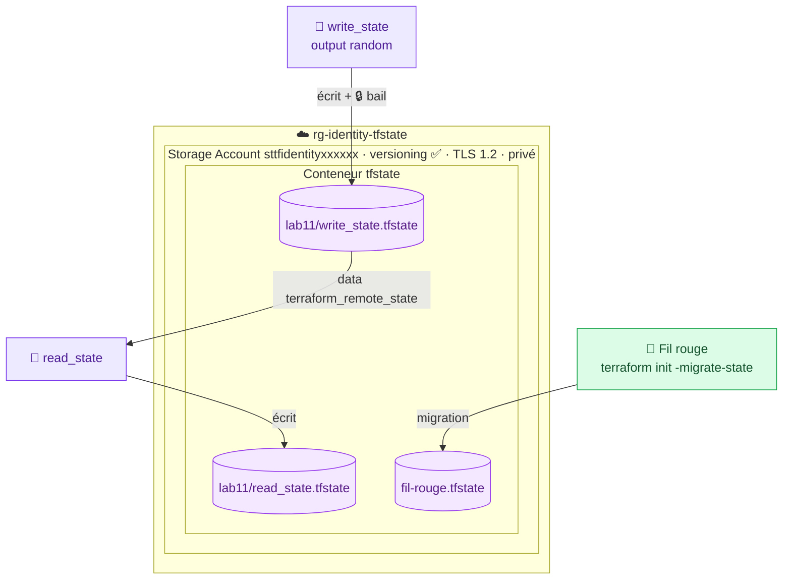

# 🟪 Lab 11 — Stocker l'état dans Azure Storage

  

## 🎯 Objectifs

À la fin de ce lab, vous serez capable de :

- ✅ **préparer** un compte de stockage sécurisé pour les états (versioning, TLS 1.2, pas d'accès public) ;
- ✅ **configurer** un backend `azurerm` avec une **configuration partielle** (`-backend-config`) ;
- ✅ **lire** un état distant avec `terraform_remote_state` ;
- ✅ **provoquer** et **expliquer** le verrouillage (bail de blob) ;
- ✅ **migrer** l'état local du fil rouge vers Azure sans rien recréer.

## 📋 Prérequis

Fil rouge déployé (lab 09). `source ~/.azure-tf.env` fait.

## 🗺️ Architecture



> [!NOTE]
> Le lab d'origine utilisait Terraform Cloud comme backend. Sur Azure, le backend natif est un **Storage Account** ; HCP Terraform est abordé au lab 12.

---

## Étape 1 — Préparer le stockage des états

Le stockage doit exister **avant** le projet qui l'utilise (problème de l'œuf et de la poule) : on le crée avec l'Azure CLI.

```bash
mkdir -p ~/terraform-azure/lab11 && cd $_
# Connexion de la CLI avec votre SP (même identité que Terraform)
az login --service-principal -u "$ARM_CLIENT_ID" -p "$ARM_CLIENT_SECRET" --tenant "$ARM_TENANT_ID" -o none
```

Créez `bootstrap.sh` :

```bash
#!/usr/bin/env bash
set -euo pipefail
IDENTITY="${1:?Usage : bash bootstrap.sh <identity>}"

RG="rg-${IDENTITY}-tfstate"
SA="sttf${IDENTITY}$(openssl rand -hex 3)"   # 3 à 24 caractères [a-z0-9], unique dans tout Azure
LOCATION="francecentral"

az group create --name "$RG" --location "$LOCATION" -o none

az storage account create --name "$SA" --resource-group "$RG" --location "$LOCATION" \
  --sku Standard_LRS --min-tls-version TLS1_2 --allow-blob-public-access false -o none

# ✏️ TODO 1 : activer le versioning des blobs (az storage account blob-service-properties update …)

ACCOUNT_KEY=$(az storage account keys list -g "$RG" -n "$SA" --query '[0].value' -o tsv)
az storage container create --name tfstate --account-name "$SA" --account-key "$ACCOUNT_KEY" -o none

cat > ~/.tfstate.env <<EOT
export TFSTATE_RG="$RG"
export TFSTATE_SA="$SA"
export ARM_ACCESS_KEY="$ACCOUNT_KEY"
EOT
chmod 600 ~/.tfstate.env
echo "✅ Compte de stockage : $SA"
```

```bash
bash bootstrap.sh <identity>
source ~/.tfstate.env
```

> [!TIP]
> Le nom du compte est **aléatoire** : il est mémorisé dans `~/.tfstate.env`. Sans ce fichier, retrouvez-le avec `az storage account list -g rg-<identity>-tfstate --query [].name -o tsv`.

> [!CAUTION]
> `ARM_ACCESS_KEY` donne un accès **total** au compte de stockage. En production, on préfère l'authentification Entra ID (`use_azuread_auth = true`) avec le rôle *Storage Blob Data Contributor*.

---

## Étape 2 — Un projet qui stocke son état dans Azure

```bash
mkdir -p ~/terraform-azure/lab11/write_state && cd $_
```

`main.tf` :

```hcl
terraform {
  required_version = ">= 1.9"

  backend "azurerm" {
    container_name = "tfstate"
    key            = "lab11/write_state.tfstate"
  }

  required_providers {
    random = {
      source  = "hashicorp/random"
      version = "~> 3.6"
    }
  }
}

resource "random_id" "random" {
  keepers = {
    uuid = uuid()   # nouvelle valeur à chaque apply
  }
  byte_length = 8
}

output "random" {
  value = random_id.random.hex
}
```

> [!IMPORTANT]
> Le bloc `backend` est lu **avant** les variables : **aucune** `var.*` n'y est permise. Les valeurs propres à chacun sont passées à l'`init` (**configuration partielle**).

```bash
terraform init \
  -backend-config="resource_group_name=$TFSTATE_RG" \
  -backend-config="storage_account_name=$TFSTATE_SA"
terraform apply -auto-approve
ls terraform.tfstate 2>/dev/null || echo "✅ aucun état local"
az storage blob list --container-name tfstate --account-name "$TFSTATE_SA" -o table
```

Dans le portail (Storage Account → Conteneurs → `tfstate`), ouvrez le blob : c'est le JSON de l'état.

---

## Étape 3 — Un projet qui lit l'état distant

```bash
mkdir -p ~/terraform-azure/lab11/read_state && cd $_
```

`variables.tf` :

```hcl
variable "tfstate_rg" {
  type = string
}

variable "tfstate_sa" {
  type = string
}
```

`main.tf` : même bloc `terraform` que `write_state`, avec `key = "lab11/read_state.tfstate"`, la même ressource `random_id`, puis :

```hcl
data "terraform_remote_state" "write_state" {
  backend = "azurerm"

  config = {
    resource_group_name  = var.tfstate_rg
    storage_account_name = var.tfstate_sa
    container_name       = "tfstate"
    key                  = "____"   # ✏️ TODO 2
  }
}

output "random" {
  value = random_id.random.hex
}

output "write_state_random" {
  value = data.terraform_remote_state.write_state.outputs.random
}
```

✏️ **TODO 3** — Fournissez `tfstate_rg` et `tfstate_sa` **sans fichier** : quelles variables d'environnement exporter ?

```bash
terraform init -backend-config="resource_group_name=$TFSTATE_RG" -backend-config="storage_account_name=$TFSTATE_SA"
terraform apply -auto-approve
```

```text
Outputs:

random             = "c1597ca0fbba3997"
write_state_random = "0de9168d0b78ead6"
```

---

## Étape 4 — 🔒 Observer le verrouillage

Ouvrez **deux terminaux** dans `write_state`, et dans chacun : `source ~/.azure-tf.env && source ~/.tfstate.env`.

| Terminal 1 | Terminal 2 |
|---|---|
| `terraform apply` et **ne répondez pas** | |
| | `terraform apply` |

```text
Error: Error acquiring the state lock
Error message: state blob is already locked
Lock Info:
  ID:        a1b2c3d4-...
  Path:      tfstate/lab11/write_state.tfstate
  Operation: OperationTypeApply
  Who:       student01@poste
```

Le backend pose un **bail (lease)** sur le blob. Répondez `no` dans le terminal 1 : le verrou est libéré.

✏️ **TODO 4** — Dans le portail, pendant que le terminal 1 attend, quel est l'**état du bail** du blob (*Lease state*) ?

> [!WARNING]
> Verrou orphelin (crash, Ctrl+C brutal) : `terraform force-unlock <ID>`, **uniquement** si vous êtes sûr que plus aucune commande ne tourne.

---

## Étape 5 — Migrer l'état du fil rouge

```bash
cd ~/terraform-azure/terraform
terraform plan     # doit afficher No changes AVANT la migration
```

Créez `backend.tf` :

```hcl
terraform {
  backend "azurerm" {
    container_name = "tfstate"
    key            = "fil-rouge.tfstate"
  }
}
```

```bash
terraform init -migrate-state \
  -backend-config="resource_group_name=$TFSTATE_RG" \
  -backend-config="storage_account_name=$TFSTATE_SA"
```

```text
Do you want to copy existing state to the new backend?
  Enter a value: yes
```

```bash
terraform plan     # ✅ No changes : l'état a bien été migré
mkdir -p ~/backup-tfstate && mv terraform.tfstate* ~/backup-tfstate/
```

### 🔍 Observer

✏️ **TODO 5** — Le projet `lab10/secondary` lit encore `../../terraform/terraform.tfstate`. Que se passe-t-il maintenant ? Adaptez-le au backend `azurerm`.

---

## ✅ Vérification

- [ ] Les blobs `lab11/write_state.tfstate`, `lab11/read_state.tfstate` et `fil-rouge.tfstate` existent.
- [ ] Vous avez provoqué et compris l'erreur de verrouillage.
- [ ] `terraform plan` sur le fil rouge indique **No changes** après la migration.
- [ ] `az storage account show -n $TFSTATE_SA --query "{tls:minimumTlsVersion, public:allowBlobPublicAccess}"` → `TLS1_2`, `false`.

## 🧯 Si vous voyez…

| Message | Cause | Solution |
|---|---|---|
| `Variables not allowed` dans `backend` | `var.*` dans le bloc backend | configuration partielle `-backend-config` |
| `Backend configuration changed` | backend modifié depuis le dernier init | `terraform init -reconfigure` (ou `-migrate-state`) |
| `StorageAccountAlreadyTaken` | nom déjà pris dans Azure | relancez `bootstrap.sh` (suffixe aléatoire) |
| `Failed to get existing workspaces: … AuthorizationFailure` | `ARM_ACCESS_KEY` absent | `source ~/.tfstate.env` |
| `state blob is already locked` | verrou actif | attendez, ou `force-unlock` en dernier recours |

## 🏆 Défi

Supprimez le blob `lab11/write_state.tfstate` dans le portail, puis **restaurez** la version précédente grâce au versioning (onglet *Versions* du blob). `terraform plan` dans `write_state` doit retrouver l'état.

## ❓ Questions de compréhension

1. Pourquoi ne peut-on pas utiliser de variables dans un bloc `backend` ?
2. Quels sont les 4 avantages d'un état distant sur un état local ?
3. Que fait exactement `terraform init -migrate-state` ? Modifie-t-il des ressources Azure ?
