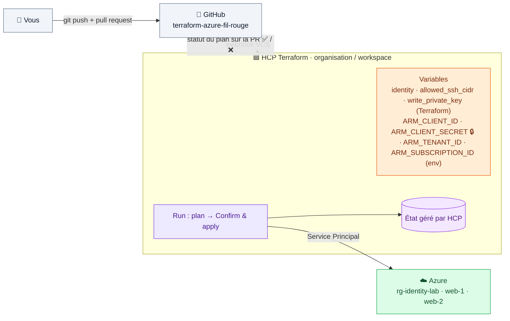

# 🟪 Lab 12 — HCP Terraform et GitHub (workflow VCS)

   

## 🎯 Objectifs

À la fin de ce lab, vous serez capable de :

- ✅ **connecter** un workspace HCP Terraform à un dépôt GitHub ;
- ✅ **configurer** les variables Terraform et les identifiants Azure (`ARM_*`, marqués *Sensitive*) d'un workspace ;
- ✅ **diagnostiquer** un plan qui échoue et le **corriger** par une pull request ;
- ✅ **lire** un plan spéculatif sur une PR, puis **appliquer** et **détruire** depuis l'interface ;
- ✅ **adapter** une configuration à une exécution sur des runners éphémères.

## 📋 Prérequis

- Compte HCP Terraform gratuit : <https://app.terraform.io/>.
- Compte GitHub.
- Vos valeurs `ARM_*` : `cat ~/.azure-tf.env`.

## 🗺️ Architecture



---

## Étape 1 — Préparer le code et le dépôt

### 1.1 Détruire l'infrastructure locale

HCP Terraform va gérer **son propre état**. Pour éviter deux copies de la même infrastructure :

```bash
cd ~/terraform-azure/terraform
terraform destroy
az group delete --name rg-<identity>-shared --yes    # groupe "partagé" du lab 09
```

### 1.2 Adapter le code à une exécution distante

1. Supprimez `backend.tf` (lab 11) : l'état sera stocké par HCP Terraform.
2. Les runners HCP sont **éphémères** : écrire `keys/<identity>.pem` n'y a aucun sens. Rendez le fichier optionnel :

```hcl
variable "write_private_key" {
  description = "Écrire la clé privée dans keys/ (false sur HCP Terraform)"
  type        = bool
  default     = true
}
```

```diff
 resource "local_sensitive_file" "private_key" {
+  count = ____   # ✏️ TODO 1 : 1 si write_private_key, sinon 0
+
   content         = tls_private_key.ssh.private_key_pem
```

3. Vérifiez le `.gitignore` (lab 02) et que `.terraform.lock.hcl` **est** bien présent.

> [!WARNING]
> **Ne retirez pas** la source de données `rg-<identity>-shared` du lab 09 : son échec est l'objet de l'étape 3.

### 1.3 Pousser sur GitHub

Créez sur GitHub un dépôt **privé et vide** `terraform-azure-fil-rouge`, puis :

```bash
git init -b main
git add .
git status          # ⚠️ aucun *.tfstate, *.tfvars, keys/ ne doit apparaître
git commit -m "Fil rouge Terraform Azure"
git remote add origin https://github.com/<github-user>/terraform-azure-fil-rouge.git
git push -u origin main
```

> [!TIP]
> `.terraform.lock.hcl` **doit** être versionné : HCP Terraform utilisera exactement vos versions de providers.

### 1.4 Créer l'organisation et le workspace

1. Sur <https://app.terraform.io/>, créez une organisation (nom unique) si nécessaire.
2. **New → Workspace → Version Control Workflow → GitHub.com** → **Authorize**.
3. Choisissez `terraform-azure-fil-rouge`, laissez les options par défaut → **Create**.

---

## Étape 2 — Configurer les variables

Onglet **Variables** du workspace :

| Type | Clé | Valeur | Sensible |
|---|---|---|---|
| 🟪 Terraform | `identity` | `<identity>` | non |
| 🟪 Terraform | `allowed_ssh_cidr` | `*` | non |
| 🟪 Terraform | `write_private_key` | `false` (cochez **HCL**) | non |
| 🟧 Environment | `ARM_CLIENT_ID` | `appId` du SP | non |
| 🟥 Environment | `ARM_CLIENT_SECRET` | secret du SP | ✅ **oui** |
| 🟧 Environment | `ARM_TENANT_ID` | tenant | non |
| 🟧 Environment | `ARM_SUBSCRIPTION_ID` | abonnement | non |

> [!CAUTION]
> `allowed_ssh_cidr = "*"` : les provisioners se connectent en SSH **depuis les runners HCP**, dont les IP varient. Le port 22 est donc ouvert à Internet pendant ce lab. C'est une des raisons de préférer `custom_data` (lab 06) en production.

> [!NOTE]
> Une variable **Sensitive** est en écriture seule : elle n'est plus jamais affichée, même pour vous.

✏️ **TODO 2** — Pourquoi `write_private_key = false` doit-il être coché **HCL** ?

---

## Étape 3 — Lancer un plan (il va échouer)

**Actions → Start new run → Plan and apply**, puis ouvrez le run.

### 🔍 Observer

✏️ **TODO 3** — Recopiez le message d'erreur. Quelle ressource du code est en cause, et pourquoi ce plan réussissait-il en local ?

---

## Étape 4 — Corriger par une pull request

### 4.1 Modifier le code dans une branche

```bash
git switch -c fix-shared-rg
```

✏️ **TODO 4** — Supprimez du code ce qui provoque l'erreur (2 blocs), puis :

```bash
terraform fmt && terraform validate
git commit -am "Retire la lecture du groupe partagé supprimé"
git push -u origin fix-shared-rg
```

Sur GitHub : **Compare & pull request** → **Create pull request**.

### 4.2 Le plan spéculatif

Après quelques secondes, la PR affiche un check **Terraform plan has changes**. Cliquez **Details** : HCP Terraform a exécuté un **plan spéculatif** (jamais appliqué) sur le code de la branche.

✏️ **TODO 5** — Combien de ressources à créer ? Retrouvez dans le détail les 2 VM et leurs IP publiques.

### 4.3 Fusionner

**Merge pull request** → **Confirm merge**.

---

## Étape 5 — Confirmer et appliquer

Onglet **Runs** : le commit de fusion déclenche un run. Une fois le plan terminé : **Confirm & apply** → **Confirm plan**.

Suivez l'exécution : les provisioners se connectent en SSH depuis les runners HCP. À la fin, ouvrez une URL de l'output `urls`.

Explorez **States** : l'historique des versions de l'état est conservé et consultable.

---

## Étape 6 — Détruire

**Settings → Destruction and Deletion → Queue destroy plan** → saisissez le nom du workspace → **Confirm & apply**.

> [!IMPORTANT]
> Vérifiez dans le portail Azure que `rg-<identity>-lab` a bien disparu.

---

## ✅ Vérification

- [ ] Le premier run a échoué avec une erreur compréhensible.
- [ ] La PR affiche le résultat du plan spéculatif.
- [ ] L'apply depuis HCP a créé les VM et la page web répond.
- [ ] L'infrastructure est détruite à la fin du lab.

## 🧯 Si vous voyez…

| Message | Cause | Solution |
|---|---|---|
| `subscription ID could not be determined` | `ARM_SUBSCRIPTION_ID` absent ou de type Terraform | variable de type **Environment** |
| `No value for required variable "identity"` | variable non définie ou de type Environment | type **Terraform** |
| `Invalid value for input variable … a bool is required` | `write_private_key` non coché HCL | cochez **HCL** |
| `timeout … dial tcp …:22` | `allowed_ssh_cidr` ≠ `*` | voir étape 2 |
| `Error: Failed to read ssh public key` | un `file("~/.ssh/…")` traîne dans le code | utilisez la clé `tls` (lab 05) |


