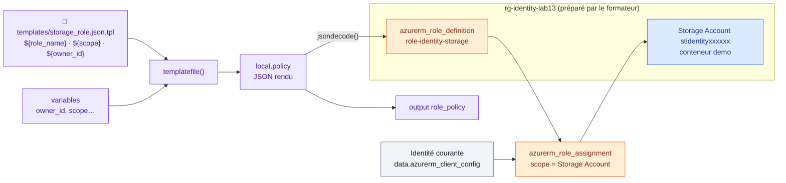

# 🟧 Lab 13 — La fonction `templatefile` et Azure RBAC

  

## 🎯 Objectifs

À la fin de ce lab, vous serez capable de :

- ✅ **écrire** un modèle de fichier avec des espaces réservés `${...}` ;
- ✅ **rendre** ce modèle avec `templatefile` et **le décoder** avec `jsondecode` ;
- ✅ **créer** un rôle personnalisé Azure RBAC et **l'attribuer** à l'identité courante sur un compte de stockage ;
- ✅ **vérifier** l'accès aux données avec `--auth-mode login`, sans clé de compte.

> [!NOTE]
> Sur AWS, le modèle produisait une politique IAM attachée à un bucket S3. Sur Azure, l'équivalent est une **définition de rôle RBAC** attribuée sur un Storage Account.

## 📋 Prérequis

- Étapes 1 et 2 : Terraform uniquement, **aucune** connexion à Azure.
- Étape 3 : le groupe **`rg-<identity>-lab13`, préparé par le formateur**, sur lequel votre SP est *User Access Administrator*.

> [!IMPORTANT]
> Avec le seul rôle **Contributor**, il est **impossible** de créer un rôle personnalisé ou une attribution de rôle (`Microsoft.Authorization/*/write`). C'est pourquoi le formateur a préparé ce groupe avec un droit supplémentaire, limité à lui seul.

## 🗺️ Architecture



---

## Étape 1 — Écrire le modèle

```bash
mkdir -p ~/terraform-azure/lab13/templates && cd ~/terraform-azure/lab13
```

`templates/storage_role.json.tpl` :

```json
{
  "Name": "${role_name}",
  "Description": "Gestion des conteneurs et blobs du compte ${storage_account_name} par ${owner_id}",
  "Actions": [
    "Microsoft.Storage/storageAccounts/read",
    "Microsoft.Storage/storageAccounts/blobServices/containers/read",
    "Microsoft.Storage/storageAccounts/blobServices/containers/write",
    "Microsoft.Storage/storageAccounts/blobServices/containers/delete"
  ],
  "DataActions": [
    "Microsoft.Storage/storageAccounts/blobServices/containers/blobs/read",
    "Microsoft.Storage/storageAccounts/blobServices/containers/blobs/write",
    "Microsoft.Storage/storageAccounts/blobServices/containers/blobs/delete"
  ],
  "AssignableScopes": ["${scope}"]
}
```

| Bloc | Plan | Exemple |
|---|---|---|
| 🟦 `Actions` | **contrôle** : gérer le compte et les conteneurs | créer un conteneur |
| 🟩 `DataActions` | **données** : lire et écrire les blobs | télécharger un fichier |

> [!TIP]
> Dans un modèle, `${variable}` s'écrit **sans préfixe** (`var.`, `local.`…) : seules les valeurs passées explicitement à `templatefile` sont visibles. Suffixe conseillé : `.json.tpl` (contenu `.json`, modèle `.tpl`).

---

## Étape 2 — Rendre le modèle (sans Azure)

`main.tf` :

```hcl
variable "owner_id" {
  type    = string
  default = "anaconda"
}

locals {
  storage_account_name = "st${var.owner_id}demo"

  policy = templatefile("${path.module}/templates/storage_role.json.tpl", {
    owner_id             = var.owner_id
    role_name            = "role-${var.owner_id}-storage"
    storage_account_name = local.storage_account_name
    scope                = "/subscriptions/00000000-0000-0000-0000-000000000000/resourceGroups/rg-${var.owner_id}-lab13"
  })
}

output "role_policy" {
  value = local.policy
}
```

```bash
terraform init && terraform apply
terraform console
> jsondecode(local.policy).DataActions
> length(jsondecode(local.policy).Actions)
```

✏️ **TODO 1** — Retirez `owner_id` de la map passée à `templatefile` et relancez `terraform plan`. Quel message obtenez-vous ? Remettez-le.

---

## Étape 3 — Créer le stockage et attacher le rôle

### 3.1 Les fichiers

Remplacez le contenu du projet par quatre fichiers.

`providers.tf` : `azurerm ~> 4.0` et `random ~> 3.6`, provider `azurerm` avec `features {}`.

`variables.tf` :

```hcl
variable "owner_id" {
  type = string

  validation {
    condition     = can(regex("^[a-z0-9]{3,12}$", var.owner_id))
    error_message = "owner_id : 3 à 12 caractères, minuscules et chiffres."
  }
}
```

`terraform.tfvars` : `owner_id = "<identity>"`.

`main.tf` :

```hcl
data "azurerm_client_config" "current" {}

# Groupe préparé par le formateur : on le LIT, on ne le crée pas
data "azurerm_resource_group" "lab13" {
  name = "rg-${var.owner_id}-lab13"
}

resource "random_string" "suffix" {
  length  = 6
  upper   = false
  special = false
}

resource "azurerm_storage_account" "demo" {
  name                            = "st${var.owner_id}${random_string.suffix.result}"
  resource_group_name             = data.azurerm_resource_group.lab13.name
  location                        = data.azurerm_resource_group.lab13.location
  account_tier                    = "Standard"
  account_replication_type        = "LRS"
  min_tls_version                 = "TLS1_2"
  allow_nested_items_to_be_public = false
}

resource "azurerm_storage_container" "demo" {
  name                  = "demo"
  storage_account_id    = azurerm_storage_account.demo.id
  container_access_type = "private"
}
```

> [!WARNING]
> Le lab d'origine utilisait `uuid()` dans le nom du bucket. `uuid()` change à **chaque** exécution : la ressource serait **recréée à chaque `apply`**. `random_string` génère une valeur **une seule fois** et la conserve dans l'état.

### 3.2 Rendre le modèle avec les vraies valeurs et créer le rôle

```hcl
locals {
  policy = templatefile("${path.module}/templates/storage_role.json.tpl", {
    owner_id             = var.owner_id
    role_name            = "role-${var.owner_id}-storage"
    storage_account_name = azurerm_storage_account.demo.name
    scope                = ____   # ✏️ TODO 2 : l'ID du groupe de ressources
  })

  role = jsondecode(local.policy)
}

resource "azurerm_role_definition" "storage" {
  name        = local.role.Name
  description = local.role.Description
  scope       = data.azurerm_resource_group.lab13.id

  permissions {
    actions      = local.role.Actions
    data_actions = ____   # ✏️ TODO 3
  }

  assignable_scopes = local.role.AssignableScopes
}

resource "azurerm_role_assignment" "me" {
  scope              = azurerm_storage_account.demo.id
  role_definition_id = azurerm_role_definition.storage.role_definition_resource_id
  principal_id       = data.azurerm_client_config.current.object_id
}
```

`outputs.tf` : `role_policy` (= `local.policy`) et `storage_account` (= nom du compte).

> [!NOTE]
> Un rôle personnalisé est **défini** sur un abonnement ou un groupe (`AssignableScopes`), puis **attribué** à un niveau plus fin : ici, le compte de stockage.

### 3.3 Appliquer

```bash
terraform init -upgrade
terraform apply
```

✏️ **TODO 4** — Notez le résumé du plan. Pourquoi le groupe de ressources n'en fait-il pas partie ?

### 3.4 Tester le rôle

Attendez **1 à 2 minutes** (propagation RBAC), puis déposez un fichier **avec votre SP**, sans clé de compte :

```bash
az login --service-principal -u "$ARM_CLIENT_ID" -p "$ARM_CLIENT_SECRET" --tenant "$ARM_TENANT_ID" -o none
SA=$(terraform output -raw storage_account)
echo "Hello RBAC" > hello.txt
az storage blob upload --auth-mode login --account-name "$SA" --container-name demo --name hello.txt --file hello.txt
az storage blob list   --auth-mode login --account-name "$SA" --container-name demo -o table
```

Vérifiez dans le portail : Storage Account → **Contrôle d'accès (IAM)** → **Attributions de rôles**.

---

## 🧹 Nettoyage

```bash
terraform destroy      # le groupe rg-<identity>-lab13 est conservé (il n'est que lu)
```

## ✅ Vérification

- [ ] L'output `role_policy` affiche le JSON rendu avec vos valeurs.
- [ ] Le rôle `role-<identity>-storage` apparaît dans le portail.
- [ ] L'upload avec `--auth-mode login` fonctionne.

## 🧯 Si vous voyez…

| Message | Cause | Solution |
|---|---|---|
| `AuthorizationFailed … Microsoft.Authorization/roleDefinitions/write` | groupe non préparé ou mauvais groupe | prévenez le formateur |
| `Resource Group "rg-…-lab13" was not found` | groupe non préparé | prévenez le formateur |
| `RoleDefinitionDoesNotExist` à l'attribution | propagation du rôle pas terminée | relancez `terraform apply` |
| `This request is not authorized to perform this operation using this permission` (upload) | propagation RBAC (1 à 5 min) ou CLI connectée avec un autre compte | attendez ; `az account show` |
| `Invalid template interpolation value` | variable manquante dans la map de `templatefile` | ajoutez-la |

## 🏆 Défi

Rendez la liste `DataActions` **paramétrable** : passez une liste `data_actions` à `templatefile` et générez le tableau JSON avec `${jsonencode(data_actions)}` dans le modèle.

## ❓ Questions de compréhension

1. Pourquoi un modèle ne voit-il pas `var.owner_id` directement ?
2. Différence entre `Actions` et `DataActions` ?
3. Pourquoi le rôle **Contributor** ne permet-il pas ce lab ?
4. Pourquoi préférer `random_string` à `uuid()` dans un nom de ressource ?
