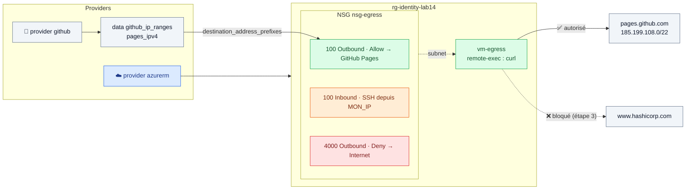

# 🟧 Lab 14 — Multi‑provider : Azure et GitHub

  

## 🎯 Objectifs

À la fin de ce lab, vous serez capable de :

- ✅ **combiner** deux providers (`azurerm` et `github`) dans une même configuration ;
- ✅ **authentifier** un provider tiers par variable d'environnement, **sans** secret dans les fichiers ;
- ✅ **utiliser** les données d'un provider (plages IP de GitHub Pages) dans les ressources d'un autre (règles NSG) ;
- ✅ **justifier** l'usage de `depends_on` quand aucune référence ne relie deux ressources ;
- ✅ **vérifier** un filtrage sortant avec un provisioner de test.

## 📋 Prérequis

- `source ~/.azure-tf.env` fait.
- Un compte GitHub. Jeton **recommandé** (évite la limite de 60 requêtes/h des appels anonymes) : GitHub → *Settings* → *Developer settings* → *Fine-grained tokens* → *Generate new token*, **sans aucune permission**.

## 🗺️ Architecture



---

## Étape 1 — Le projet et les deux providers

```bash
mkdir -p ~/terraform-azure/lab14 && cd $_
export GITHUB_TOKEN="github_pat_xxxxxxxx"     # dans le terminal, JAMAIS dans un fichier .tf / .tfvars
```

> [!CAUTION]
> L'ancienne version de ce lab mettait `github_token` dans `terraform.tfvars`. **À proscrire** : ce fichier finit souvent dans Git. Le provider GitHub lit `GITHUB_TOKEN` tout seul, comme `azurerm` lit `ARM_*`.

`providers.tf` :

```hcl
terraform {
  required_version = ">= 1.9"

  required_providers {
    azurerm = {
      source  = "hashicorp/azurerm"
      version = "~> 4.0"
    }
    github = {
      source  = "____"     # ✏️ TODO 1 : source du provider GitHub sur le registre
      version = "~> 6.0"
    }
    tls = {
      source  = "hashicorp/tls"
      version = "~> 4.0"
    }
  }
}

provider "azurerm" {
  features {}
}

provider "github" {}   # jeton lu dans GITHUB_TOKEN
```

`variables.tf` : `identity` (avec validation), `location` (défaut `francecentral`), `allowed_ssh_cidr`, et :

```hcl
variable "restrict_egress" {
  description = "Étape 3 : n'autoriser la sortie que vers GitHub Pages"
  type        = bool
  default     = false
}
```

`terraform.tfvars` : `identity` et `allowed_ssh_cidr` **uniquement**.

---

## Étape 2 — Le réseau, la VM et le test sans restriction

Dans `main.tf`, commencez par la source de données GitHub :

```hcl
data "github_ip_ranges" "gh" {}

output "github_pages_ipv4" {
  value = data.github_ip_ranges.gh.pages_ipv4
}
```

Puis ajoutez, sur le modèle des labs précédents : groupe `rg-${var.identity}-lab14`, VNet `10.14.0.0/16`, subnet `10.14.1.0/24`, NSG `nsg-egress` **vide**, règle séparée `azurerm_network_security_rule.ssh_in` (priorité 100, entrant, port 22 depuis `var.allowed_ssh_cidr`), association NSG ↔ subnet, clé `tls_private_key.ssh`, IP publique, NIC et VM `vm-egress`.

Dans la VM, la dépendance vers le NSG (sinon le SSH du provisioner peut échouer) et le test réseau :

```hcl
  depends_on = [
    azurerm_network_security_rule.ssh_in,
    azurerm_subnet_network_security_group_association.vm,
  ]

  connection {
    type        = "ssh"
    user        = "azureuser"
    private_key = tls_private_key.ssh.private_key_pem
    host        = self.public_ip_address
  }

  provisioner "remote-exec" {
    inline = [
      "echo '--- GitHub Pages ---'",
      "curl -s -o /dev/null -w 'HTTP %%{http_code}\\n' --max-time 10 https://pages.github.com",
      "echo '--- hashicorp.com ---'",
      "curl -s -o /dev/null -w 'HTTP %%{http_code}\\n' --max-time 10 https://www.hashicorp.com",
    ]
  }
```

> [!NOTE]
> `%%{` est l'échappement HCL de `%{`, qui serait sinon interprété comme une directive de template.

```bash
terraform init
terraform apply
```

```text
azurerm_linux_virtual_machine.vm (remote-exec): --- GitHub Pages ---
azurerm_linux_virtual_machine.vm (remote-exec): HTTP 200
azurerm_linux_virtual_machine.vm (remote-exec): --- hashicorp.com ---
azurerm_linux_virtual_machine.vm (remote-exec): HTTP 200
```

Les deux destinations répondent : par défaut, un NSG autorise tout le trafic sortant vers Internet (règle `AllowInternetOutBound`, priorité 65001).

---

## Étape 3 — N'autoriser la sortie que vers GitHub Pages

### 3.1 Les règles sortantes, conditionnelles

```hcl
resource "azurerm_network_security_rule" "allow_github_pages" {
  count = var.restrict_egress ? 1 : 0

  name                         = "Allow-GitHub-Pages-Out"
  priority                     = 100
  direction                    = "Outbound"
  access                       = "Allow"
  protocol                     = "*"
  source_port_range            = "*"
  destination_port_range       = "*"
  source_address_prefix        = "*"
  destination_address_prefixes = ____   # ✏️ TODO 2 : les plages IP de GitHub Pages
  resource_group_name          = azurerm_resource_group.rg.name
  network_security_group_name  = azurerm_network_security_group.egress.name
}

resource "azurerm_network_security_rule" "deny_internet" {
  count = var.restrict_egress ? 1 : 0

  name                        = "Deny-Internet-Out"
  priority                    = 4000
  direction                   = "Outbound"
  access                      = "Deny"
  protocol                    = "*"
  source_port_range           = "*"
  destination_port_range      = "*"
  source_address_prefix       = "*"
  destination_address_prefix  = "Internet"   # service tag Azure
  resource_group_name         = azurerm_resource_group.rg.name
  network_security_group_name = azurerm_network_security_group.egress.name
}
```

| Priorité | Règle | Effet |
|---|---|---|
| 🟩 100 | Allow → `pages_ipv4` | GitHub Pages autorisé |
| 🟥 4000 | Deny → `Internet` | tout le reste bloqué |
| ⬜ 65001 | `AllowInternetOutBound` (défaut) | jamais atteinte |

### 3.2 La dépendance explicite

Le provisioner teste le réseau : les règles doivent exister **avant** la VM. ✏️ **TODO 3** — Complétez le `depends_on` de la VM avec les **deux nouvelles** règles. Pourquoi Terraform ne peut-il pas deviner seul ces dépendances ?

### 3.3 🔍 Appliquer et observer l'échec (volontaire)

Les provisioners ne s'exécutent qu'à la création : on recrée la VM.

```bash
terraform apply -var="restrict_egress=true" -replace="azurerm_linux_virtual_machine.vm"
```

```text
azurerm_linux_virtual_machine.vm (remote-exec): --- GitHub Pages ---
azurerm_linux_virtual_machine.vm (remote-exec): HTTP 200
azurerm_linux_virtual_machine.vm (remote-exec): --- hashicorp.com ---
azurerm_linux_virtual_machine.vm (remote-exec): HTTP 000
╷
│ Error: remote-exec provisioner error
│ ... error executing "/tmp/terraform_xxxx.sh": Process exited with status 28
```

✏️ **TODO 4** — Que signifie le code 28 de `curl` ? Dans quel état se trouve maintenant la VM pour Terraform ?

> [!NOTE]
> Le trafic de retour des connexions SSH entrantes reste autorisé : les NSG sont **stateful**. La résolution DNS fonctionne aussi : l'adresse de plateforme `168.63.129.16` n'est pas soumise aux NSG.

---

## 🧹 Nettoyage

```bash
terraform destroy -var="restrict_egress=true"
unset GITHUB_TOKEN
```

## ✅ Vérification

- [ ] Étape 2 : les deux `curl` renvoient `HTTP 200`.
- [ ] Étape 3 : seul GitHub Pages répond, le provisioner échoue sur `hashicorp.com`.
- [ ] `grep -r github_pat .` ne renvoie **rien**.

## 🧯 Si vous voyez…

| Message | Cause | Solution |
|---|---|---|
| `GET https://api.github.com/meta: 401 Bad credentials` | jeton invalide ou expiré | régénérez-le ou `unset GITHUB_TOKEN` (mode anonyme) |
| `403 API rate limit exceeded` | trop d'appels anonymes (IP partagée de la salle) | définissez `GITHUB_TOKEN` |
| `SecurityRuleConflict` / priorité déjà utilisée | deux règles de même priorité et direction | changez la priorité |
| Provisioner en timeout SSH | votre IP a changé | mettez à jour `allowed_ssh_cidr` |

## 🏆 Défi

Autorisez aussi la sortie vers les plages `git_ipv4` de GitHub (pour `git clone`), dans **la même** règle `Allow`, avec `concat()`. Vérifiez avec un `curl https://github.com` ajouté au provisioner.

## ❓ Questions de compréhension

1. Comment chaque provider trouve-t-il ses identifiants dans ce lab ?
2. Pourquoi `depends_on` est-il nécessaire ici, alors qu'il est inutile la plupart du temps ?
3. Pourquoi la règle Deny est-elle en priorité 4000 et pas 100 ?
4. À quoi sert `count = var.restrict_egress ? 1 : 0` ?
