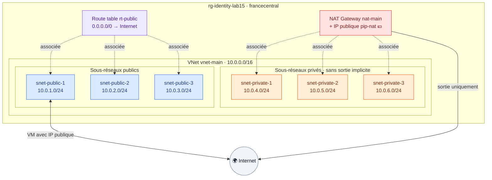

# 🟦 Lab 15 — Réseau virtuel Azure complet (VNet)

   

## 🎯 Objectifs

À la fin de ce lab, vous serez capable de :

- ✅ **construire** un VNet avec 3 sous-réseaux publics et 3 privés générés par **un seul** bloc `for_each` ;
- ✅ **filtrer** une map avec une expression `for … if` ;
- ✅ **associer** une table de routage aux sous-réseaux publics et une **NAT Gateway** aux privés ;
- ✅ **expliquer** les différences de conception réseau entre AWS et Azure.

## 📋 Prérequis

`source ~/.azure-tf.env` fait. Aucun lab précédent requis.

## 🗺️ Architecture



## 🔁 AWS et Azure : ce qui change

| AWS (lab d'origine) | Azure |
|---|---|
| `aws_vpc` | `azurerm_virtual_network` |
| Subnet lié à **une** zone de disponibilité | Subnet **régional** ; la zone se choisit sur la VM ou l'IP |
| `map_public_ip_on_launch` | Pas d'équivalent : une VM est « publique » si on lui associe une IP publique |
| Internet Gateway obligatoire | Pas de ressource : routes **système** |
| Route table + associations | `azurerm_route_table` + `azurerm_subnet_route_table_association` |
| NAT Gateway | `azurerm_nat_gateway` |
| Subnet privé = pas de route vers l'IGW | `default_outbound_access_enabled = false` + NAT Gateway |
| `enable_dns_support` / `enable_dns_hostnames` | Activés par défaut (DNS Azure `168.63.129.16`) |

> [!NOTE]
> Azure réserve **5 adresses** par sous-réseau (`.0`, `.1`, `.2`, `.3` et `.255`) : un `/24` offre donc 251 adresses utilisables.

---

## Étape 1 — Le projet et le VNet

```bash
mkdir -p ~/terraform-azure/lab15-16 && cd $_
```

`providers.tf` : `azurerm ~> 4.0`, `required_version >= 1.9`, provider avec `features {}`.

`variables.tf` : `identity` (avec validation `^[a-z0-9]{3,12}$`) et `location` (défaut `francecentral`).

`terraform.tfvars` : `identity = "<identity>"`.

`vnet.tf` :

```hcl
resource "azurerm_resource_group" "rg" {
  name     = "rg-${var.identity}-lab15"
  location = var.location
}

resource "azurerm_virtual_network" "main" {
  name                = "vnet-main"
  address_space       = ["10.0.0.0/16"]
  location            = azurerm_resource_group.rg.location
  resource_group_name = azurerm_resource_group.rg.name

  tags = {
    Name = "main"
  }
}
```

---

## Étape 2 — Les sous-réseaux avec un seul `for_each`

Le lab d'origine écrivait six blocs presque identiques. Ajoutez à `vnet.tf` :

```hcl
locals {
  subnets = {
    public-1  = { cidr = "10.0.1.0/24", public = true }
    public-2  = { cidr = "10.0.2.0/24", public = true }
    public-3  = { cidr = "10.0.3.0/24", public = true }
    private-1 = { cidr = "10.0.4.0/24", public = false }
    private-2 = { cidr = "10.0.5.0/24", public = false }
    private-3 = { cidr = "10.0.6.0/24", public = false }
  }

  public_subnets  = { for k, v in local.subnets : k => v if v.public }
  private_subnets = ____   # ✏️ TODO 1 : les sous-réseaux NON publics
}

resource "azurerm_subnet" "main" {
  for_each = local.subnets

  name                 = "snet-${each.key}"
  resource_group_name  = azurerm_resource_group.rg.name
  virtual_network_name = azurerm_virtual_network.main.name
  address_prefixes     = [each.value.cidr]

  # Privés : pas d'accès sortant implicite, la sortie passera par la NAT Gateway
  default_outbound_access_enabled = each.value.public
}
```

> [!TIP]
> Les ressources sont adressées par **clé** : `azurerm_subnet.main["public-1"]`. Testez dans `terraform console` : `local.public_subnets`, `keys(local.private_subnets)`.

---

## Étape 3 — L'accès Internet des sous-réseaux publics

Sur AWS, il fallait une Internet Gateway. Sur Azure, chaque sous-réseau dispose déjà de **routes système**, dont `0.0.0.0/0 → Internet` : une VM avec une IP publique communique avec Internet sans ressource supplémentaire. Vous le vérifierez au lab 16 :

```bash
az network nic show-effective-route-table -g rg-<identity>-lab15 -n nic-web -o table
```

---

## Étape 4 — La table de routage publique

Pour reproduire explicitement la logique du lab d'origine (et pouvoir plus tard router vers un pare-feu) :

```hcl
resource "azurerm_route_table" "public" {
  name                = "rt-public"
  location            = azurerm_resource_group.rg.location
  resource_group_name = azurerm_resource_group.rg.name

  route {
    name           = "default-to-internet"
    address_prefix = "0.0.0.0/0"
    next_hop_type  = "Internet"
  }

  tags = {
    Name = "main-public"
  }
}
```

## Étape 5 — L'associer aux sous-réseaux publics

✏️ **TODO 2** — Écrivez `azurerm_subnet_route_table_association.public` avec un `for_each` sur `local.public_subnets` (arguments : `subnet_id`, `route_table_id`).

---

## Étape 6 — La NAT Gateway des sous-réseaux privés

Créez `nat.tf` :

```hcl
resource "azurerm_public_ip" "nat" {
  name                = "pip-nat"
  location            = azurerm_resource_group.rg.location
  resource_group_name = azurerm_resource_group.rg.name
  allocation_method   = "Static"
  sku                 = "Standard"
}

resource "azurerm_nat_gateway" "main" {
  name                    = "nat-main"
  location                = azurerm_resource_group.rg.location
  resource_group_name     = azurerm_resource_group.rg.name
  sku_name                = "Standard"
  idle_timeout_in_minutes = 10
}

resource "azurerm_nat_gateway_public_ip_association" "main" {
  nat_gateway_id       = azurerm_nat_gateway.main.id
  public_ip_address_id = azurerm_public_ip.nat.id
}

resource "azurerm_subnet_nat_gateway_association" "private" {
  for_each = ____   # ✏️ TODO 3

  subnet_id      = azurerm_subnet.main[each.key].id
  nat_gateway_id = azurerm_nat_gateway.main.id
}
```

> [!WARNING]
> **Coût :** la NAT Gateway est facturée à l'heure, même sans trafic. Détruisez-la à la fin du lab 16.

---

## Étape 7 — Outputs et déploiement

`outputs.tf` :

```hcl
output "subnet_ids" {
  value = { for k, s in azurerm_subnet.main : k => s.id }
}

output "nat_public_ip" {
  value = azurerm_public_ip.nat.ip_address
}
```

```bash
terraform init
terraform plan
```

### 🔍 Observer

✏️ **TODO 4** — Avant d'appliquer, **calculez** le nombre de ressources attendu (groupe, VNet, sous-réseaux, table, associations, IP, NAT…), puis comparez avec le plan.

```bash
terraform apply
az network vnet subnet list -g rg-<identity>-lab15 --vnet-name vnet-main \
  --query "[].{nom:name, plage:addressPrefix, routeTable:routeTable.id!=null, nat:natGateway.id!=null}" -o table
```

> [!IMPORTANT]
> **Ne détruisez pas** ce réseau : le lab 16 déploie une VM dedans.

---

## ✅ Vérification

- [ ] Le VNet contient 6 sous-réseaux.
- [ ] Les 3 publics sont associés à `rt-public`, les 3 privés à `nat-main`.
- [ ] `terraform plan` affiche `No changes`.

## 🧯 Si vous voyez…

| Message | Cause | Solution |
|---|---|---|
| `NetcfgInvalidSubnet` / chevauchement | deux sous-réseaux sur la même plage | vérifiez les CIDR |
| `Unsupported argument "default_outbound_access_enabled"` | provider azurerm trop ancien | `terraform init -upgrade` (≥ 4.0) |
| `InUseSubnetCannotBeDeleted` au destroy | une VM du lab 16 utilise encore le subnet | détruisez tout le projet ensemble |

## 🏆 Défi

Remplacez les CIDR écrits en dur par un calcul : `cidrsubnet("10.0.0.0/16", 8, n)`. Construisez `local.subnets` avec deux expressions `for` (publics : n = 1 à 3, privés : n = 4 à 6) et vérifiez que le plan affiche **No changes**.

## ❓ Questions de compréhension

1. Pourquoi n'y a-t-il pas d'Internet Gateway sur Azure ?
2. Qu'est-ce qui rend un sous-réseau « privé » dans ce lab ?
3. Combien d'adresses utilisables dans un `/27` sur Azure ?
4. Pourquoi un seul bloc `for_each` est-il préférable à six blocs `azurerm_subnet` ?

## 🚀 Pour aller plus loin

- Le module vérifié `Azure/avm-res-network-virtualnetwork/azurerm`.
- **Azure Bastion** pour administrer les VM privées sans IP publique.
