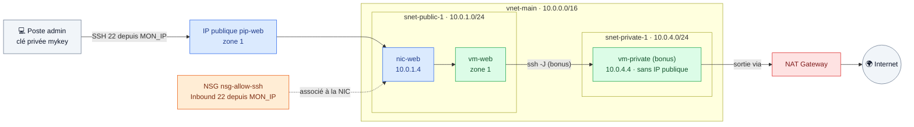

# 🟩 Lab 16 — Machine virtuelle dans le VNet

   

## 🎯 Objectifs

À la fin de ce lab, vous serez capable de :

- ✅ **déployer** une VM dans un sous-réseau précis d'un VNet existant, dans une **zone** donnée ;
- ✅ **protéger** la VM avec un NSG attaché à sa **carte réseau** ;
- ✅ **vérifier** depuis la VM son adresse privée, ses routes et ses métadonnées (IMDS) ;
- ✅ **joindre** une VM privée par rebond SSH et **prouver** qu'elle sort par la NAT Gateway.

## 📋 Prérequis

Lab 15 déployé dans `~/terraform-azure/lab15-16`. On ajoute les fichiers de ce lab **dans le même répertoire** : la VM référence directement `azurerm_subnet.main["public-1"]` et l'état reste unique.

> [!NOTE]
> Le lab d'origine copiait `terraform.tfstate` dans un nouveau répertoire. Pour séparer réellement deux couches, on utiliserait plutôt `terraform_remote_state` (labs 10 et 11).

## 🗺️ Architecture



---

## Étape 1 — La paire de clés SSH

```bash
cd ~/terraform-azure/lab15-16
ssh-keygen -t rsa -b 4096 -f mykey -N ""
echo -e "mykey\nmykey.pub" >> .gitignore
```

---

## Étape 2 — La configuration de la VM

### 2.1 Variables

Ajoutez à `variables.tf` :

```hcl
variable "allowed_ssh_cidr" {
  type = string
}

variable "vm_size" {
  type    = string
  default = "Standard_B1s"
}

variable "vm_zone" {
  description = "Zone de disponibilité de la VM et de son IP"
  type        = string
  default     = "1"
}

variable "path_to_public_key" {
  type    = string
  default = "mykey.pub"
}

variable "instance_username" {
  type    = string
  default = "azureuser"
}
```

Ajoutez `allowed_ssh_cidr = "<MON_IP>/32"` à `terraform.tfvars`.

> [!TIP]
> Vérifiez que la taille existe dans la zone : `az vm list-skus -l francecentral --size Standard_B1s --query "[].locationInfo[0].zones" -o tsv`.

### 2.2 Le NSG

`securitygroup.tf` :

```hcl
resource "azurerm_network_security_group" "allow_ssh" {
  name                = "nsg-allow-ssh"
  location            = azurerm_resource_group.rg.location
  resource_group_name = azurerm_resource_group.rg.name

  security_rule {
    name                       = "Allow-SSH"
    priority                   = 100
    direction                  = "Inbound"
    access                     = "Allow"
    protocol                   = "Tcp"
    source_port_range          = "*"
    destination_port_range     = "22"
    source_address_prefix      = var.allowed_ssh_cidr
    destination_address_prefix = "*"
  }

  tags = {
    Name = "allow-ssh"
  }
}
```

### 2.3 La VM

`instance.tf` :

```hcl
resource "azurerm_public_ip" "web" {
  name                = "pip-web"
  location            = azurerm_resource_group.rg.location
  resource_group_name = azurerm_resource_group.rg.name
  allocation_method   = "Static"
  sku                 = "Standard"
  zones               = [var.vm_zone]
}

resource "azurerm_network_interface" "web" {
  name                = "nic-web"
  location            = azurerm_resource_group.rg.location
  resource_group_name = azurerm_resource_group.rg.name

  ip_configuration {
    name                          = "internal"
    subnet_id                     = ____   # ✏️ TODO 1 : le sous-réseau public-1 du lab 15
    private_ip_address_allocation = "Dynamic"
    public_ip_address_id          = azurerm_public_ip.web.id
  }
}

# Le NSG est attaché à la CARTE RÉSEAU (au lab 02, il l'était au subnet)
resource "azurerm_network_interface_security_group_association" "web" {
  network_interface_id      = azurerm_network_interface.web.id
  network_security_group_id = azurerm_network_security_group.allow_ssh.id
}

resource "azurerm_linux_virtual_machine" "web" {
  name                  = "vm-web"
  location              = azurerm_resource_group.rg.location
  resource_group_name   = azurerm_resource_group.rg.name
  size                  = var.vm_size
  zone                  = var.vm_zone
  admin_username        = var.instance_username
  network_interface_ids = [azurerm_network_interface.web.id]

  admin_ssh_key {
    username   = var.instance_username
    public_key = file(var.path_to_public_key)
  }

  os_disk {
    caching              = "ReadWrite"
    storage_account_type = "Standard_LRS"
  }

  source_image_reference {
    publisher = "Canonical"
    offer     = "ubuntu-24_04-lts"
    sku       = "server"
    version   = "latest"
  }
}
```

> [!NOTE]
> `zone = "1"` est l'équivalent de l'`availability_zone` d'AWS. Sur Azure, la zone se fixe sur la VM et l'IP publique, **pas** sur le sous-réseau. L'IP doit être dans la même zone que la VM (ou *zone-redundant*).

✏️ **TODO 2** — Ajoutez à `outputs.tf` deux outputs : `vm_public_ip` (IP publique) et `vm_private_ip` (IP privée de la VM).

---

## Étape 3 — Planifier et appliquer

```bash
terraform plan
```

### 🔍 Observer

✏️ **TODO 3** — Vérifiez dans le plan que le VNet et les sous-réseaux **ne sont pas modifiés**. Combien de ressources à créer ?

```bash
terraform apply
```

---

## Étape 4 — Tester depuis la VM

```bash
ssh -i mykey azureuser@$(terraform output -raw vm_public_ip)
```

Sur la VM :

```bash
ip -4 addr show eth0        # adresse 10.0.1.x/24 (pas .1, .2, .3 : réservées)
ip route                    # routes (net-tools / "route -n" n'est pas installé sur Ubuntu 24.04)
curl -s -H Metadata:true "http://169.254.169.254/metadata/instance/compute?api-version=2021-02-01" \
  | python3 -m json.tool | grep -E '"(name|zone|vmSize|location)"'
exit
```

```text
default via 10.0.1.1 dev eth0 proto dhcp src 10.0.1.4 metric 100
10.0.1.0/24 dev eth0 proto kernel scope link src 10.0.1.4 metric 100
168.63.129.16 via 10.0.1.1 dev eth0 proto dhcp src 10.0.1.4 metric 100
169.254.169.254 via 10.0.1.1 dev eth0 proto dhcp src 10.0.1.4 metric 100
```

| Adresse | Rôle |
|---|---|
| 🟦 `10.0.1.1` | passerelle virtuelle Azure du sous-réseau (1ʳᵉ adresse réservée) |
| 🟪 `168.63.129.16` | DNS et services de la plateforme Azure |
| 🟩 `169.254.169.254` | service de métadonnées de l'instance (IMDS) |

> [!NOTE]
> L'IP publique n'apparaît **pas** sur l'interface : comme sur AWS, elle est traduite (NAT 1:1) par la plateforme.

Depuis votre poste, comparez avec les **routes effectives** vues par Azure :

```bash
az network nic show-effective-route-table -g rg-<identity>-lab15 -n nic-web -o table
```

---

## 🏆 Bonus — Une VM privée derrière la NAT Gateway

✏️ **TODO 4** — Créez `instance-private.tf` : une NIC `nic-private` dans `private-1` **sans** IP publique et une VM `vm-private` (sans zone), sur le modèle de `vm-web`. Ajoutez l'output `vm_private_only_ip`.

```bash
terraform apply
eval "$(ssh-agent -s)" && ssh-add mykey
ssh -J azureuser@$(terraform output -raw vm_public_ip) azureuser@$(terraform output -raw vm_private_only_ip)
```

Sur la VM privée :

```bash
curl -s https://ifconfig.me ; echo
```

L'adresse affichée est celle de la **NAT Gateway** (`terraform output nat_public_ip`) : la VM sort vers Internet sans être joignable depuis Internet.

> [!TIP]
> En production, la VM de rebond est remplacée par **Azure Bastion**.

---

## 🧹 Nettoyage — fin de formation

```bash
terraform destroy                      # VM + réseau + NAT Gateway
bash ~/terraform_GK/scripts/nettoyage.sh <identity>   # filet de sécurité : tous vos rg-<identity>-*
```

> [!CAUTION]
> Vérifiez qu'il ne reste rien : `az group list --query "[?starts_with(name,'rg-<identity>-')].name" -o table`.

## ✅ Vérification

- [ ] Connexion SSH à `vm-web` avec `mykey`.
- [ ] `ip -4 addr show eth0` montre une adresse `10.0.1.x/24`.
- [ ] `ip route` montre la passerelle `10.0.1.1`.
- [ ] Bonus : `vm-private` sort avec l'IP de la NAT Gateway.
- [ ] Tout est détruit en fin de lab.

## 🧯 Si vous voyez…

| Message | Cause | Solution |
|---|---|---|
| `ZonalAllocationFailed` / `SkuNotAvailable` | taille indisponible dans la zone | `vm_zone = "2"` ou autre taille |
| `Public IP … zones do not match` | IP et VM dans des zones différentes | même `var.vm_zone` des deux côtés |
| `route: command not found` | `net-tools` absent d'Ubuntu 24.04 | `ip route` |
| `ssh -J` : `Permission denied` sur la 2ᵉ VM | clé non chargée dans l'agent | `ssh-add mykey` |

## ❓ Questions de compréhension

1. Pourquoi la zone se choisit-elle sur la VM et pas sur le sous-réseau ?
2. Quelle différence entre un NSG attaché au subnet et un NSG attaché à la NIC ?
3. Pourquoi la VM privée est-elle joignable depuis `vm-web` mais pas depuis Internet ?
4. À quoi sert l'adresse `169.254.169.254` ?
