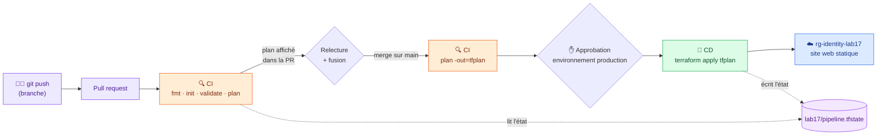

# 🟪 Lab 17 — Terraform dans un pipeline DevOps (GitHub Actions)

  

## 🎯 Objectifs

À la fin de ce lab, vous serez capable de :

- ✅ **versionner** un projet Terraform prêt pour l'automatisation (état distant, lock file, aucun secret) ;
- ✅ **donner** à un pipeline un accès sécurisé à Azure (secrets et variables GitHub) ;
- ✅ **écrire** un workflow qui **vérifie et planifie** à chaque pull request (CI) puis **applique** après fusion sur `main` (CD) ;
- ✅ **modifier** l'infrastructure **uniquement par Git**, sans lancer `terraform apply` vous‑même ;
- ✅ **exiger** une approbation humaine avant la mise en production.

## 📋 Prérequis

- Lab 01 : principal de service et fichier `~/.azure-tf.env`.
- Lab 11 : compte de stockage des états et fichier `~/.tfstate.env` (`TFSTATE_RG`, `TFSTATE_SA`).
- Un compte GitHub. La CLI `gh` est recommandée (`gh auth login`).

## 🤔 Pourquoi un pipeline ?

| Depuis le poste du développeur | Depuis un pipeline |
|---|---|
| Chacun a sa version de Terraform et ses identifiants | Une seule version, un seul compte technique |
| On peut oublier `fmt`, `validate` ou `plan` | Les vérifications s'exécutent **à chaque fois** |
| Personne ne relit le plan | Le plan est visible dans la pull request |
| On ne sait pas qui a changé quoi | Chaque changement = un commit + une PR + une exécution tracée |
| L'état peut être local | L'état est **obligatoirement** distant : la machine du pipeline est jetable |

## 🗺️ Architecture



> [!NOTE]
> L'infrastructure est volontairement minuscule : un **site web statique** dans un compte de stockage (5 ressources, ≈ 1 min, quasi gratuit). Le sujet du lab, c'est le **pipeline**.

### Arborescence de votre dépôt

```text
tf-pipeline-<identity>/
├── .github/workflows/
│   ├── terraform.yml        # pipeline CI/CD
│   └── destroy.yml          # destruction manuelle
├── infra/
│   ├── backend.tf           # état distant (configuration partielle, lab 11)
│   ├── main.tf              # groupe de ressources + site statique
│   ├── variables.tf
│   ├── outputs.tf
│   ├── terraform.tfvars     # valeurs NON secrètes, versionnées
│   ├── .terraform.lock.hcl  # versions des providers, versionné
│   └── site/index.html.tftpl
└── .gitignore
```

---

## Étape 1 — Créer le dépôt et le code Terraform

### 1.1 Le dépôt

Créez un dépôt GitHub **public** `tf-pipeline-<identity>` et clonez‑le :

```bash
gh repo create tf-pipeline-<identity> --public --clone
# ou : créer le dépôt sur github.com, puis git clone https://github.com/<github-user>/tf-pipeline-<identity>.git
mv tf-pipeline-<identity> ~/terraform-azure/lab17 && cd ~/terraform-azure/lab17
mkdir -p infra/site .github/workflows
```

> [!TIP]
> Un dépôt **public** permet d'utiliser gratuitement l'approbation manuelle de l'étape 7.

### 1.2 L'état distant

Le pipeline s'exécute sur une machine **neuve à chaque fois** : un `terraform.tfstate` local serait perdu à la fin de chaque exécution. On réutilise le stockage des états du lab 11, en **configuration partielle**.

`infra/backend.tf` :

```hcl
terraform {
  backend "azurerm" {
    container_name = "tfstate"
    key            = "lab17/pipeline.tfstate"
  }
}
```

### 1.3 L'infrastructure

`infra/main.tf` :

```hcl
terraform {
  required_version = ">= 1.9"

  required_providers {
    azurerm = {
      source  = "hashicorp/azurerm"
      version = "~> 4.0"
    }
    random = {
      source  = "hashicorp/random"
      version = "~> 3.6"
    }
  }
}

# Aucun identifiant dans le code : le provider lit les variables ARM_*
provider "azurerm" {
  features {}
}

resource "random_string" "suffix" {
  length  = 6
  upper   = false
  special = false
}

resource "azurerm_resource_group" "rg" {
  name     = "rg-${var.identity}-lab17"
  location = var.location

  tags = {
    ManagedBy = "GitHub Actions"
  }
}

resource "azurerm_storage_account" "web" {
  name                     = substr("stweb${random_string.suffix.result}${var.identity}", 0, 24)
  resource_group_name      = azurerm_resource_group.rg.name
  location                 = azurerm_resource_group.rg.location
  account_tier             = "Standard"
  account_replication_type = "LRS"
  account_kind             = "StorageV2"
}

# Active l'hébergement de site statique (crée le conteneur spécial $web)
resource "azurerm_storage_account_static_website" "web" {
  storage_account_id = azurerm_storage_account.web.id
  index_document     = "index.html"
}

# La page d'accueil, générée à partir d'un modèle (cf. lab 13)
resource "azurerm_storage_blob" "index" {
  name                   = "index.html"
  storage_account_name   = azurerm_storage_account.web.name
  storage_container_name = "$web"
  type                   = "Block"
  content_type           = "text/html; charset=utf-8"

  source_content = templatefile("${path.module}/site/index.html.tftpl", {
    identity    = var.identity
    message     = var.message
    environment = var.environment
  })

  depends_on = [azurerm_storage_account_static_website.web]
}
```

`infra/variables.tf` :

```hcl
variable "identity" {
  description = "Identifiant unique du participant"
  type        = string

  validation {
    condition     = can(regex("^[a-z0-9]{3,12}$", var.identity))
    error_message = "identity : 3 à 12 caractères, minuscules et chiffres uniquement."
  }
}

variable "location" {
  type    = string
  default = "francecentral"
}

variable "environment" {
  type    = string
  default = "production"
}

variable "message" {
  type    = string
  default = "Bonjour ! Ce site a été déployé par un pipeline."
}
```

`infra/terraform.tfvars` :

```hcl
identity = "<identity>"
message  = "Bonjour ! Ce site a été déployé par un pipeline."
```

`infra/outputs.tf` :

```hcl
output "website_url" {
  value = azurerm_storage_account.web.primary_web_endpoint
}

output "storage_account" {
  value = azurerm_storage_account.web.name
}
```

`infra/site/index.html.tftpl` :

```html
<!DOCTYPE html>
<html lang="fr">
<head><meta charset="utf-8"><title>Lab 17 — ${identity}</title></head>
<body style="font-family: sans-serif; max-width: 640px; margin: 4rem auto">
  <h1>${message}</h1>
  <p>Environnement : <strong>${environment}</strong> · Participant : <code>${identity}</code></p>
  <p>git push → GitHub Actions → terraform plan → terraform apply → Azure</p>
</body>
</html>
```

`.gitignore` (racine du dépôt) :

```gitignore
.terraform/
*.tfstate
*.tfstate.*
tfplan
crash.log
```

> [!IMPORTANT]
> Dans les autres labs, on ne versionne pas `terraform.tfvars`. Ici, on le versionne **volontairement** : il ne contient **aucun secret**, et le pipeline en a besoin. Les secrets, eux, iront dans GitHub (étape 3).

---

## Étape 2 — Vérifier en local (sans appliquer)

Le pipeline exécutera **les mêmes commandes** que vous. Vérifiez qu'elles passent :

```bash
source ~/.azure-tf.env && source ~/.tfstate.env
cd infra
terraform init -backend-config="resource_group_name=$TFSTATE_RG" \
               -backend-config="storage_account_name=$TFSTATE_SA"
terraform fmt -check -recursive
terraform validate
terraform plan
```

✅ Résultat attendu : `Plan: 5 to add, 0 to change, 0 to destroy.`

> [!CAUTION]
> **N'exécutez pas `terraform apply`.** À partir de maintenant, **seul le pipeline** modifie Azure.

```bash
cd ..
git add .
git status          # 🔍 .terraform.lock.hcl doit apparaître, pas .terraform/
git commit -m "Code Terraform du site statique"
git push
```

---

## Étape 3 — Donner au pipeline l'accès à Azure

Le pipeline s'authentifie avec votre **principal de service** (lab 01). Ses identifiants vont dans les **secrets** du dépôt : chiffrés, jamais affichés dans les journaux. L'emplacement de l'état, qui n'est pas secret, va dans les **variables** du dépôt.

| Type | Nom | Valeur |
|---|---|---|
| 🔒 Secret | `ARM_CLIENT_ID` | `appId` du principal de service |
| 🔒 Secret | `ARM_CLIENT_SECRET` | `password` du principal de service |
| 🔒 Secret | `ARM_TENANT_ID` | `tenant` |
| 🔒 Secret | `ARM_SUBSCRIPTION_ID` | ID de l'abonnement |
| 📄 Variable | `TFSTATE_RG` | groupe des états (lab 11) |
| 📄 Variable | `TFSTATE_SA` | compte de stockage des états (lab 11) |

Avec la CLI `gh` :

```bash
source ~/.azure-tf.env && source ~/.tfstate.env
for s in ARM_CLIENT_ID ARM_CLIENT_SECRET ARM_TENANT_ID ARM_SUBSCRIPTION_ID; do
  gh secret set "$s" --body "${!s}"
done
gh variable set TFSTATE_RG --body "$TFSTATE_RG"
gh variable set TFSTATE_SA --body "$TFSTATE_SA"
gh secret list && gh variable list
```

Ou dans l'interface : **Settings → Secrets and variables → Actions**, onglets *Secrets* et *Variables*.

> [!NOTE]
> Le principal de service a le rôle **Contributor** : il peut lire la clé du compte de stockage des états. `ARM_ACCESS_KEY` n'est donc pas nécessaire dans le pipeline.

---

## Étape 4 — Écrire le pipeline et déclencher le premier déploiement

### 4.1 Le workflow

`.github/workflows/terraform.yml` — complétez les **✏️ TODO** :

```yaml
name: Terraform

on:
  pull_request:
    branches: [main]
    paths: ["infra/**", ".github/workflows/terraform.yml"]
  push:
    branches: [main]
    paths: ["infra/**", ".github/workflows/terraform.yml"]
  workflow_dispatch:

permissions:
  contents: read

concurrency:
  group: terraform-state
  cancel-in-progress: false

env:
  ARM_CLIENT_ID: ${{ secrets.ARM_CLIENT_ID }}
  ARM_CLIENT_SECRET: ${{ secrets.ARM_CLIENT_SECRET }}
  ARM_TENANT_ID: ${{ secrets.ARM_TENANT_ID }}
  ARM_SUBSCRIPTION_ID: ${{ secrets.ARM_SUBSCRIPTION_ID }}
  TFSTATE_RG: ${{ vars.TFSTATE_RG }}
  TFSTATE_SA: ${{ vars.TFSTATE_SA }}
  TF_IN_AUTOMATION: "true"
  TF_INPUT: "false"

defaults:
  run:
    working-directory: infra

jobs:
  plan:
    name: "CI — vérifier et planifier"
    runs-on: ubuntu-latest
    steps:
      - uses: actions/checkout@v4

      - uses: hashicorp/setup-terraform@v3
        with:
          terraform_version: "1.9.8"
          terraform_wrapper: false

      - name: terraform fmt
        run: terraform fmt -check -recursive

      - name: terraform init
        run: >-
          terraform init
          -backend-config="resource_group_name=$TFSTATE_RG"
          -backend-config="storage_account_name=$TFSTATE_SA"

      # ✏️ TODO 1 : ajouter une étape « terraform validate »

      - name: terraform plan
        run: terraform plan -out=tfplan

      - name: Publier le plan dans le résumé
        run: |
          {
            echo "## Plan Terraform"
            echo '```'
            terraform show -no-color tfplan
            echo '```'
          } >> "$GITHUB_STEP_SUMMARY"

      - name: Conserver le plan
        if: github.event_name != 'pull_request'
        uses: actions/upload-artifact@v4
        with:
          name: tfplan
          path: infra/tfplan
          retention-days: 1

  apply:
    name: "CD — appliquer"
    needs: plan
    # ✏️ TODO 2 : n'exécuter ce job que sur la branche main, et jamais pour une pull request
    #            (indices : github.ref, github.event_name)
    runs-on: ubuntu-latest
    environment: production
    steps:
      - uses: actions/checkout@v4

      - uses: hashicorp/setup-terraform@v3
        with:
          terraform_version: "1.9.8"
          terraform_wrapper: false

      - name: Récupérer le plan
        uses: actions/download-artifact@v4
        with:
          name: tfplan
          path: infra

      - name: terraform init
        run: >-
          terraform init
          -backend-config="resource_group_name=$TFSTATE_RG"
          -backend-config="storage_account_name=$TFSTATE_SA"

      - name: terraform apply
        run: terraform apply tfplan

      - name: Afficher l'adresse du site
        run: |
          echo "### Site déployé : $(terraform output -raw website_url)" >> "$GITHUB_STEP_SUMMARY"
```

### 🔍 Observer : lire le workflow

| Élément | Rôle |
|---|---|
| `on: pull_request` / `on: push` | Une PR déclenche **seulement la CI** ; un push sur `main` déclenche **CI + CD** |
| `paths` | Le pipeline ne tourne que si le code Terraform ou le workflow change |
| `concurrency` | Deux exécutions ne modifient jamais l'état en même temps |
| `env: ARM_*` | Les secrets deviennent des variables d'environnement, lues par le provider (comme `source ~/.azure-tf.env`) |
| `TF_INPUT: "false"` | Terraform ne pose jamais de question : sans clavier, il échoue au lieu d'attendre |
| `terraform fmt -check` | Échoue si le code est mal formaté : une **porte qualité** |
| `plan -out=tfplan` + artefact | Le job `apply` applique **exactement** le plan calculé, pas un nouveau |
| `needs: plan` | Le déploiement n'a lieu que si toutes les vérifications ont réussi |
| `apply tfplan` | Un plan enregistré s'applique sans `-auto-approve` |
| `environment: production` | Point d'accroche pour l'approbation manuelle (étape 7) |

### 4.2 Pousser et observer

```bash
git add .github/workflows/terraform.yml
git commit -m "Pipeline Terraform CI/CD"
git push
```

Onglet **Actions** du dépôt :

1. le job **CI — vérifier et planifier** passe au vert ; son résumé affiche le plan (`5 to add`) ;
2. le job **CD — appliquer** crée les ressources ;
3. le résumé affiche `Site déployé : https://stweb….web.core.windows.net/`.

✅ Ouvrez l'adresse : la page affiche votre message. Dans le portail, le groupe `rg-<identity>-lab17` porte le tag `ManagedBy = GitHub Actions`.

---

## Étape 5 — Modifier l'infrastructure par une pull request

C'est le cycle de travail quotidien : **branche → PR → plan relu → fusion → déploiement**.

```bash
git switch -c nouveau-message
```

```diff
- message  = "Bonjour ! Ce site a été déployé par un pipeline."
+ message  = "Version 2 : déployée après relecture d'une pull request"
```

```bash
git commit -am "Nouveau message d'accueil"
git push -u origin nouveau-message
gh pr create --fill          # ou « Compare & pull request » sur GitHub
```

### 🔍 Observer

- seul le job **CI** s'exécute ; le job **CD** est *skipped* ;
- le résumé du plan indique `1 to change` (le blob `index.html`) : c'est ce que le relecteur valide ;
- **le site n'a pas changé**.

Fusionnez la PR (**Merge pull request**) : le push sur `main` relance CI **et** CD. Rechargez le site.

```bash
git switch main && git pull
```

---

## Étape 6 — Le pipeline comme garde‑fou

### 6.1 Une erreur de format

```bash
git switch -c test-format
```

Dégradez volontairement l'alignement dans `infra/outputs.tf` :

```diff
  output "storage_account" {
-   value = azurerm_storage_account.web.name
+   value      =     azurerm_storage_account.web.name
  }
```

```bash
git commit -am "Test : code mal formaté"
git push -u origin test-format
gh pr create --fill
```

🔍 La CI échoue à l'étape **terraform fmt** ; les étapes suivantes ne s'exécutent pas. Corrigez sans retoucher à la main :

```bash
terraform -chdir=infra fmt
git commit -am "terraform fmt"
git push
```

✅ La PR repasse au vert. Fusionnez‑la : le plan affiche `No changes`.

### 6.2 L'idempotence

**Actions → Terraform → Run workflow** (branche `main`), sans rien changer :

```text
No changes. Your infrastructure matches the configuration.
```

✏️ **TODO 3** — Dans le portail, modifiez à la main un tag du groupe `rg-<identity>-lab17`, puis relancez le pipeline. Que montre le plan ? Que se passe‑t‑il après l'apply ? Quel lien faites‑vous avec la **dérive (drift)** du lab 07 ?

---

## Étape 7 — Exiger une approbation avant de déployer

Le job `apply` est rattaché à l'environnement `production`, créé automatiquement par GitHub au premier déploiement :

1. **Settings → Environments → production** ;
2. cochez **Required reviewers** et ajoutez‑vous (ou votre binôme) ;
3. **Save protection rules**.

Faites une nouvelle modification du message par une PR, puis fusionnez‑la.

🔍 Le job CD affiche **Waiting for review** : le plan est calculé, rien n'est appliqué. **Review deployments → Approve and deploy**.

> [!IMPORTANT]
> C'est la frontière entre **livraison continue** (un humain valide la mise en production) et **déploiement continu** (tout passe automatiquement).

---

## Étape 8 — Nettoyage par le pipeline

`.github/workflows/destroy.yml` — complétez le **✏️ TODO 4** :

```yaml
name: Terraform destroy

on:
  workflow_dispatch:
    inputs:
      confirmation:
        description: 'Tapez "detruire" pour confirmer'
        required: true

permissions:
  contents: read

concurrency:
  group: terraform-state
  cancel-in-progress: false

env:
  ARM_CLIENT_ID: ${{ secrets.ARM_CLIENT_ID }}
  ARM_CLIENT_SECRET: ${{ secrets.ARM_CLIENT_SECRET }}
  ARM_TENANT_ID: ${{ secrets.ARM_TENANT_ID }}
  ARM_SUBSCRIPTION_ID: ${{ secrets.ARM_SUBSCRIPTION_ID }}
  TFSTATE_RG: ${{ vars.TFSTATE_RG }}
  TFSTATE_SA: ${{ vars.TFSTATE_SA }}
  TF_IN_AUTOMATION: "true"
  TF_INPUT: "false"

defaults:
  run:
    working-directory: infra

jobs:
  destroy:
    name: "Détruire"
    # ✏️ TODO 4 : n'exécuter ce job que si la saisie vaut exactement "detruire" (indice : inputs.confirmation)
    runs-on: ubuntu-latest
    environment: production
    steps:
      - uses: actions/checkout@v4
      - uses: hashicorp/setup-terraform@v3
        with:
          terraform_version: "1.9.8"
          terraform_wrapper: false
      - name: terraform init
        run: >-
          terraform init
          -backend-config="resource_group_name=$TFSTATE_RG"
          -backend-config="storage_account_name=$TFSTATE_SA"
      - name: terraform destroy
        run: terraform destroy -auto-approve
```

Poussez‑le sur `main`, puis **Actions → Terraform destroy → Run workflow**, saisissez `detruire`, approuvez.

```bash
az group show --name rg-<identity>-lab17   # ✅ ResourceGroupNotFound
```

> [!CAUTION]
> Ne supprimez pas le groupe `rg-<identity>-tfstate` : il contient les états de vos autres labs.

---

## ✅ Vérification

- [ ] Le premier push sur `main` a déployé le site, sans `terraform apply` local.
- [ ] Une PR n'exécute que la CI, et son résumé affiche le plan.
- [ ] La fusion de la PR a mis à jour le site.
- [ ] Un code mal formaté fait échouer la CI.
- [ ] Une relance sans modification affiche `No changes`.
- [ ] Le déploiement attend une approbation sur l'environnement `production`.
- [ ] Le workflow `Terraform destroy` a supprimé `rg-<identity>-lab17`.

## 🧯 Si vous voyez…

| Message | Cause | Solution |
|---|---|---|
| `building AzureRM Client: … ARM_CLIENT_ID` vide | secret absent ou mal nommé | `gh secret list` ; noms exacts, en majuscules |
| `Error: Missing required argument … storage_account_name` | variable `TFSTATE_SA` absente | `gh variable list` ; ce sont des **variables**, pas des secrets |
| `Error acquiring the state lock` | une autre exécution (ou votre poste) tient le verrou | attendez la fin ; `concurrency` évite ce cas entre pipelines |
| `Saved plan is stale` | l'état a changé entre le plan et l'apply | relancez le workflow : un nouveau plan sera calculé |
| `StorageAccountAlreadyTaken` | nom du compte déjà pris dans Azure | changez `identity` ou supprimez l'état puis relancez |
| Job CD *skipped* après un merge | condition `if:` du job `apply` (TODO 2) incorrecte | comparez avec `github.ref == 'refs/heads/main'` |
| La CI ne démarre pas | fichiers modifiés hors de `paths` | modifiez un fichier de `infra/`, ou **Run workflow** |

## 🏆 Défi

**Supprimez le secret client.** Remplacez `ARM_CLIENT_SECRET` par une **identité fédérée OIDC** : `az ad app federated-credential create` (sujet `repo:<github-user>/tf-pipeline-<identity>:environment:production`), `ARM_USE_OIDC: "true"` dans `env`, et `permissions: id-token: write` dans le workflow. Le pipeline ne doit plus contenir aucun mot de passe.

## ❓ Questions de compréhension

1. Pourquoi l'état ne peut‑il pas être local dans un pipeline ?
2. Pourquoi le job `apply` applique‑t‑il le fichier `tfplan` au lieu de relancer `terraform plan` ?
3. Quelle différence entre un **secret** et une **variable** GitHub ? Pourquoi `TFSTATE_SA` n'est‑il pas un secret ?
4. Que vérifie une PR ? Que fait en plus un push sur `main` ?
5. Quel est le rôle de `.terraform.lock.hcl` dans le pipeline ?

## 🚀 Pour aller plus loin

- **Protéger `main`** : *Settings → Branches* et exiger le statut **CI — vérifier et planifier** avant toute fusion.
- **Analyse de sécurité** : une étape `tflint` ou `checkov -d infra` avant le plan.
- **Plusieurs environnements** : `dev.tfvars` / `prod.tfvars`, une clé d'état par environnement, un environnement GitHub `dev` sans approbation.
- **Azure DevOps** : le même pipeline s'écrit dans `azure-pipelines.yml` ; les jobs deviennent des *stages*, les secrets une *service connection*, l'approbation se règle sur l'*environment*.
